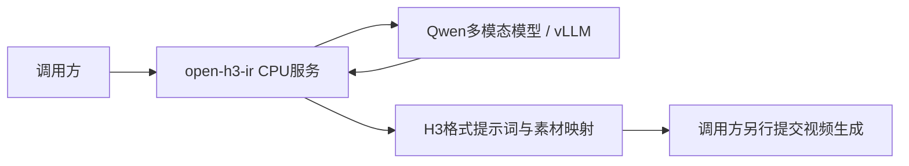

整理日期：2026-11-11。架构说明以本地固定版本为依据；我们使用的源码为`DJSaa/open-h3-ir`的`dingo-base`分支，修复版本`037d793`。上游默认分支后续可能不同。

关联阅读：[官方接口](01-minimax-official-context-ir.md) · [我们的改造与Gateway接口](03-customizations-and-gateway-api.md)。

## 项目定位

[ruashots/open-h3-ir](https://github.com/ruashots/open-h3-ir)是第三方开发的H3提示词编译器，可自行部署。它接收普通描述与素材，生成符合H3格式的提示词，并组织校验和纠错。它不是官方ContextIR源码，也不是视频生成模型。

对于我们的系统，它提供以下能力：

- 把用户的简单描述整理为场景、主体、动作、镜头与声音说明。
- 分析参考图片和视频片段，把人物、场景、物体与编号绑定起来。
- 按生成模式输出对应的H3文档结构。
- 检查格式、素材引用、台词等约束，必要时调用模型纠错。

这里不只是给Qwen包一个HTTP接口。素材分析、规划、占位符保护、规则校验、修复和结果封装由编译器负责；Qwen主要负责视觉理解及文本生成。

## 组件关系

我们的测试部署将CPU服务和Qwen推理服务放在同一个Pod的两个容器中，通过本地HTTP通信。软件架构也允许分开部署，CPU服务用`H3IR_LLM_URL`连接模型接口；是否分Pod属于部署选择，不改变编译协议。

## 编译流程

| 阶段 | 主要工作 | 关键源码 |
|---|---|---|
| 输入解析 | 校验字段、模式、尺寸及素材用途；把HTTP请求转成内部Brief | `service.py`、`mode.py`、`grid.py` |
| 素材分析 | 为图片、视频建立文字分析卡；图片/视频分析结果可以缓存 | `analyse.py` |
| 规划与草稿 | 建立素材标签、说话人及结构，准备确定性草稿 | `plan.py`、`draft.py`、`render.py` |
| 提示词编写 | 向Qwen提供原意、素材分析、H3规则和受保护台词占位符 | `prose.py` |
| 修复与校验 | 修正规则允许的结构问题，校验文档，再做有上限的纠错 | `repair.py`、`validate.py`、`compile.py` |
| 输出 | 返回最终提示词、素材映射、来源、诊断和耗时 | `service.py` |

以当前实现为例，图片逐张分析；视频在约10%、50%、90%位置抽帧后分析。最终编写时使用素材分析结果，并携带最多前两张原始图片。素材分析并行2/4做过临时实验，尚未合入当前正式镜像，不能把压测进程能力当作服务默认配置。

音频分析主要依赖角色、时长、用户说明和显式提供的转写；当前Qwen调用链不会直接听音频，也没有默认自动ASR流程。因此不能保证编译器能自行判断参考音频的真实性别、具体音色或全部内容。音色最终是否符合参考，要结合H3生成和人工听辨判断。

## 输出结构

基础模式使用三类核心内容：`integrated_multimodal_description`、`overall_soundscape`、`non_diegetic_music`。

全参考模式使用六段：`subject_definitions`、`summary`、`retention_analysis`、`detailed_description`、`overall_soundscape`、`non_diegetic_music`。人物、图片、视频、音频及对白通过各自标签建立对应关系；这些格式不是普通聊天回答。

当前分支采用英文场景描述，台词、歌词及画面文字保留原语言。原台词通过程序控制的占位符传递和恢复，不交给模型自由改写。相关强化属于我们分支的修改，详见第三份文档。

## HTTP边界

| 接口 | 用途 |
|---|---|
| `GET /health` | 健康检查 |
| `GET /v1/contract` | 读取字段、角色及契约版本 |
| `GET /v1/capabilities` | 查询能力；Gateway扩展能力见第三份文档 |
| `PUT /v1/assets/{sha256}` | 按内容哈希上传素材 |
| `POST /v1/briefs` | 同步完成一次编译，返回最终结果 |

`POST /v1/briefs`不是我们Gateway的异步任务接口。它的HTTP连接通常会一直保持到编译结束；Gateway在外层提供任务ID、查询、取消、排队和持久化。

核心请求字段有`intent`、`assets`、`seconds`、`aspect`、`megapixels`、`creativity`、`seed`和可选`dialogue`。素材通过已上传的`sha256`引用；本地路径输入是否允许由部署开关控制，不能假定远端服务能访问调用方文件路径。

返回值需要区分：

- `source=written`：采用模型编写并通过检查的结果。
- `source=draft`及`fallback_reason`：使用了确定性草稿回退，不能称为模型改写成功。
- `ir.prompt`：最终文本；`ir.manifest`：素材映射；`ir.provenance`和`ir.diagnostics`：过程与诊断信息。

我们的Gateway仅接受满足契约的`ready + written`结果，不将草稿回退包装成正常编译成功。

## 部署与使用边界

CPU服务需要素材暂存、ffmpeg/ffprobe等媒体依赖，以及可访问的多模态模型接口；Qwen需要对应权重和GPU。当前验证过的模型为Qwen3.6-27B，Qwen3.8试验不构成默认切换。

素材分析缓存和Qwen前缀缓存是两种机制：前者复用素材分析结果，后者复用相同输入前缀的模型计算；都不是完整编译结果缓存，也不能保证同seed输出绝对一致。

编译器通过检查只说明满足了已实现的约束。它不能保证视频模型一定遵循台词、参考音色、场景或动作。我们仍保留原始提示词直生成对照、多次编译和不同生成seed的质量回归。

## 依据

- [上游项目](https://github.com/ruashots/open-h3-ir)
- [本地分支说明](https://github.com/DJSaa/open-h3-ir/blob/037d7933c2a4fe4765a576c5cea1ba2e12cfbb37/docs/dingo-base.md)
- [调用文档](https://github.com/DJSaa/open-h3-ir/blob/037d7933c2a4fe4765a576c5cea1ba2e12cfbb37/docs/calling-the-api.md)
- [固定修复提交](https://github.com/DJSaa/open-h3-ir/commit/037d7933c2a4fe4765a576c5cea1ba2e12cfbb37)

注意：分支历史说明含早期独立CPU部署、v3审校等历史记录。本组文档描述的镜像版本使用v5审校；当前部署状态以第三份文档中带日期的验证记录为准。
