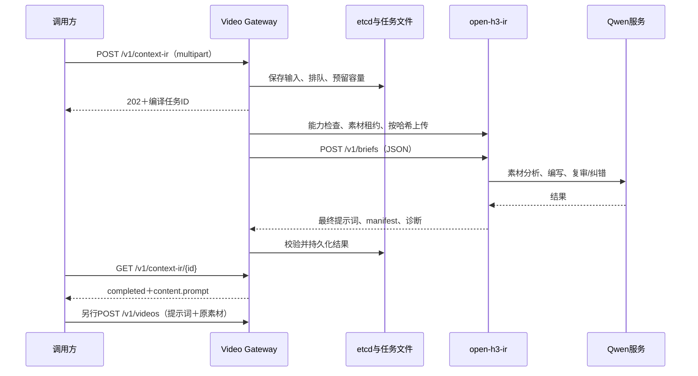

整理日期：2026-11-11。open-h3-ir基于已提交版本`037d793`；Gateway接口根据本地DingoRouter源码核对。部署参数以2026-11-06配置及2026-11-10核对记录为依据，示例地址、资源和目录均为脱敏占位值。

2026-11-14补充：已新增运行时Worker传输模式，见[ContextIR Worker部署与恢复](04-runtime-worker.md)。本文的固定HTTP上传链路作为兼容模式保留；接口字段及其含义继续有效。

关联阅读：[官方接口](01-minimax-official-context-ir.md) · [open-h3-ir介绍](02-open-h3-ir.md)。

## 1. 我们修改了什么

源码仓库：[DJSaa/open-h3-ir](https://github.com/DJSaa/open-h3-ir)，分支`dingo-base`。不是另训练一个ContextIR模型，而是在开源编译器上修复语义保护、格式和服务对接问题。

| 方向 | 已实施内容 | 解决的问题及边界 |
|---|---|---|
| 台词保护 | 从明确发言指令提取台词；保留原文、语言和标点；使用占位符恢复 | 降低丢台词、翻译台词和把说明读成对白的风险；已有结构化输入的提取仍有待覆盖场景 |
| 描述语言 | 描述采用英文；台词、歌词、画面文字保留原语言 | 不再把中文描述输出作为默认策略，英文描述不等于英文口播 |
| 对白格式 | 合并已识别的重复引导、拒绝嵌套对白；处理`responds` | 修复同一台词前重复生成说话人前缀 |
| v5漏检修复 | 识别同一说话引导之间夹着嘴唇动作说明的重复结构 | 实测失败样本已被校验拦住；不贪婪删除任意动作描述 |
| 对白时序 | 编译和复审提供原台词长度、语言、参考语速范围与目标总时长 | 估计仅作参考，不能覆盖用户明确的慢语速、停顿或固定时间 |
| 素材音频时长 | 明确音色源录音长度不等于目标对白长度 | 保留真实音频元数据，不以删掉元数据来规避差异 |
| 跨镜头续说 | 稳定维护整句/分段占位符，检查全文重复和空续说，约束连接标记位置 | 不把已说完的一句话继续安排在下个镜头重新说 |
| 独立纠错 | 每次纠错重新携带模式规范、原始要求、台词映射和音色绑定 | 纠错请求不依赖上一轮隐含聊天上下文；有上限，不无限重试 |
| 动作参考 | 增加并贯通`motion_reference`，优先保留显式角色 | 视频只借动作时，避免错误带入源人物或背景 |
| 结构修复 | 处理保留段说话编号、既有时间戳位置等确定性格式问题 | 不通过关闭规则把不合格输出当作成功 |
| Gateway素材协议 | 能力声明、上传素材租约、编译期间保护、配对音轨语义 | 避免上传、清理与编译之间的素材生命周期冲突 |

主要代码：`language.py`、`voice_binding.py`、`reference_roles.py`、`dialogue_schedule.py`、`prose.py`、`compile.py`、`repair.py`、`service.py`、`asset_leases.py`以及`prompts/dialogue_review.v5.txt`。

最新修复提交为[037d793](https://github.com/DJSaa/open-h3-ir/commit/037d7933c2a4fe4765a576c5cea1ba2e12cfbb37)，前序Gateway素材及对白强化提交为[bbeddca](https://github.com/DJSaa/open-h3-ir/commit/bbeddca46d0238100a1b4f418a2778b7311be6a5)。1129项本地测试和23项官方样例检查通过；视频样本改善不能外推为所有输入或seed都不会乱说话。

## 2. Gateway对接做了什么



新增的服务边界包括：

1. **统一素材入口**：复用视频接口的multipart解析、媒体与尺寸校验；原始素材和编译证据持久化，不依赖长HTTP连接保存状态。
2. **按模型路由**：`model_bindings`把公开模型名映射到编译后端。不同模型可以配置不同后端，但当前语义适配实现仍是MiniMax-H3，不能仅加一个新模型名就宣称支持其它模型。
3. **异步任务管理**：复用公共etcd事务、租约、幂等、文件操作和监控基础设施，另建ContextIR任务状态及专用存储域，不与视频任务混用。
4. **共享容量**：每个后端的执行槽在同一任务域的多个Gateway之间共享；通过etcd CAS竞争，超过执行槽的任务排队，队列满则拒绝。
5. **结果契约校验**：接受`ready/written`和`degraded/draft`，均检查非空提示词、模式、帧数、画布、素材标签/哈希/角色及配对音轨策略。降级草稿通过现有`content.prompt`返回，并在`warnings`中标明；拒绝状态不一致或素材错绑等结果。
6. **失败与恢复**：准备阶段允许有限尝试；编译调用一旦已发出，不因结果不明就盲目再次执行。无法确认执行结束时保留物理槽并隔离后端，防止超卖容量。
7. **诊断与清理**：保存实际发给编译器的JSON、响应和时序数据；按保留时间清理，并通过指标展示排队、执行槽和隔离状态。

上游素材协议使用`GET /v1/capabilities`确认能力，`PUT /v1/asset-leases/{token}`预留本次素材，`PUT /v1/assets/{sha256}`上传，`POST /v1/briefs`编译，最后`DELETE /v1/asset-leases/{token}`释放。租约当前保存在编译进程内存中；若扩成多个ContextIR实例，需保证同一次尝试的这些调用命中同一实例，或先实现共享租约/一致路由，不能仅增加Service副本和共享PVC就认为支持多实例。

`max_inflight`限制编译任务数量，不等于vLLM的`max_num_seqs`，也不等于素材分析并行度。两者配置为32只是当前部署选择，每个编译任务内部仍可能有多次Qwen调用。

## 3. Gateway新增接口

| 方法与路径 | 作用 | 常见成功响应 |
|---|---|---|
| `POST /v1/context-ir` | 提交编译任务 | 新任务202；幂等命中200 |
| `GET /v1/context-ir/{task_id}` | 查询任务及成功结果 | 200 |
| `DELETE /v1/context-ir/{task_id}` | 取消未完成任务；删除已终止结果 | 取消返回200；删除返回204 |
| `GET /v1/context-ir/{task_id}/diagnostics` | 查询阶段耗时、角色及上游规则码 | 200 |

提交采用`multipart/form-data`，素材字段为重复的`input_references`，顺序有意义。当前没有新增通用的Gateway素材上传/下载API；不能假设编译任务ID能直接替代视频生成的素材。

这些路径不等价于官方`/v2/h3_context_ir`，也不等价于open-h3-ir的同步`/v1/briefs`。当前接口模块没有独立的新增Bearer鉴权实现，外部访问权限需沿用部署入口的认证授权；不要把内部principal字段视为已实现多租户安全隔离。

### 提交字段及返回值

当前完整参数、推荐最小请求、返回字段及官方对照统一见[ContextIR API参考](05-api-reference.md)。本页保留架构及历史修复说明。

### 画幅参数与视频生成的衔接

ContextIR只解释比例、时长与素材语义，不检查视频池超分能力。新调用不需要resolution或size；1080P/2K等兼容输入不再触发超分编译拒绝。内部canvas仅用于编译契约，不作为公开画布返回。生成视频时由调用方另行选择分辨率并提交原素材。

首尾帧自动跟随图片；Ref2VA也支持省略ratio或传adaptive，并返回本地选中的具体比例。generation_parameters保留比例、时长和关键帧映射，不再提供具体像素尺寸。已有结果查询会按新公开契约投影，内部任务记录、执行证明和幂等摘要不重写。

## 4. 部署与配置

已验证部署是两个容器同Pod：open-h3-ir CPU服务＋Qwen3.6-27B推理服务。Gateway经稳定Service地址调用编译器。新镜像已包含修复，无额外源码覆盖挂载；早期独立CPU服务用于快速补丁与压测，后来已停用。

部署示例（地址、命名均为占位值）：

```yaml
context_ir:
  enabled: true
  backends:
    h3-ir:
      url: http://context-ir:8420
      adapter: open_h3_ir
      epoch: deployment-v1
      max_inflight: 32
      queue_limit: 32
  model_bindings:
    minimax-h3: h3-ir
    minimax-h3-ref2va: h3-ir
```

**默认值与部署值分开看：** 2026-11-11读取的本地Gateway源码默认`enabled=false`、`max_inflight=2`；测试部署显式开启并配置32。此前曾准备默认32的本地修改，但当前源码不是该默认值，不应仅依赖聊天记录。当前连接池代码为总64、单地址32；它也是独立于执行槽的限制，后续并发扩展需统一检查。

当前已验证的Qwen参数为TP=2、`max_num_seqs=32`、MTP3、`max_num_batched_tokens=12288`。这些是模型部署参数，不属于ContextIR请求字段。素材分析仍串行；分析并行2/4及32大请求并发只是独立压测，不在当前镜像中默认启用。

后端容量配置的revision会保存在etcd。修改`max_inflight`不能只改YAML：需在无在途任务的维护流程中同步后端记录，保证多个Gateway配置一致，再让新进程加载；无需重启etcd。运行中取消/未知执行不得直接删槽。我们本次2→32已完成同步和指标验证。

默认保留与超时（均可按配置调整）：排队600秒、准备120秒、编译600秒、整个执行900秒；输入终态保留1小时，结果保留24小时。超过保留期由清理流程处理，结果不应被当作永久业务数据库。

文件位于`<artifact-root>/_context_ir/<deployment-id>/tasks/<task-id>/`，保存规范化请求、原素材清单、路由快照、每次尝试的实际上游请求/响应及结果。多个Gateway接管任务时需要共享可读的制品存储和一致任务域。

监控包括提交/终态计数、`dingo_context_ir_inflight`、`dingo_context_ir_max_inflight`、`dingo_context_ir_queued`、`dingo_context_ir_quarantined`以及各阶段耗时。

## 5. 已验证与仍待验证

- 新镜像经Gateway的小用例编译→生成→下载/解码链路通过；其中单人音色用例仍出现绑定未解析警告，不能宣称音色已完全符合参考。
- R04修复后样本的台词转写改善，但此前也出现重复编译后回归；没有承诺所有输入都不乱说话。
- 当前新测试集已准备48条请求及6个校验样本，尚未全量执行。测试用途与实现能力须分开写。
- 素材大请求及并行实验的性能结论有固定输入、缓存和模型配置条件，不能直接推断不同素材或Gateway端到端32并发都安全。

后续质量计划与素材维护在独立ContextIR测试项目的 `context-ir-test/compiler-quality-suite-20261110/` 中，入口为该目录的 `README.md`；测试素材不随本源码仓库发布。

## 6. 源码核对入口

- 编译器：`open-h3-ir/h3ir/`，固定版本`037d793`；[分支说明](https://github.com/DJSaa/open-h3-ir/blob/037d7933c2a4fe4765a576c5cea1ba2e12cfbb37/docs/dingo-base.md)、[调用说明](https://github.com/DJSaa/open-h3-ir/blob/037d7933c2a4fe4765a576c5cea1ba2e12cfbb37/docs/calling-the-api.md)。
- Gateway：API路由：`dingo/video_gateway/context_ir/api.py`、字段校验：`dingo/video_gateway/context_ir/validation.py`、上游协议：`dingo/video_gateway/context_ir/protocol.py`、任务存储：`dingo/video_gateway/context_ir/task_store.py`、默认配置：`dingo/video_gateway/context_ir/config.py`。
- Gateway源码核对时HEAD为`af4b80e50`；本文根据当前工作区文件描述，不把未提交工作区内容自动等同于该提交的全部内容。

本文不包含集群地址、节点、namespace、内部镜像仓库地址或凭据。部署时由环境维护方提供实际参数。


## 近期实验修复的启用边界

2026-11-12的open-h3-ir源码增加了原文要求复审与专业H3输入局部修复：
`H3IR_REQUIREMENTS_REVIEW`、`H3IR_PROFESSIONAL_REPAIR`默认均关闭。
前者用于原文证据提取和有界纠错；后者让可靠识别的专业H3文档绕过全文扩写，
只做检查和必要的局部修改。普通输入仍走原有编译路径。

两项功能目前只在独立测试服务验证，不表示现有Gateway后端已默认开启。
当前复审拒绝返回HTTP502；Gateway会将其按执行结果不明处理，并可能隔离该编译后端。
这一错误分类衔接尚需统一，不能把“模型认为质量不合格”和“无法确认上游是否仍在执行”
当成同一情况。实验开关、返回诊断及限制以open-h3-ir源码的 `docs/calling-the-api.md` 为准。


## Qwen调用用量与上游计费

`POST /v1/context-ir`创建任务、`GET /v1/context-ir/{id}`查询以及诊断接口均提供顶层
`usage`。创建或尚未收到上游统计时为 `null`；编译返回后保存任务级汇总，查询和同一
`Idempotency-Key`重放不重新计数。旧任务、旧编译器以及无有效上游统计的任务仍返回 `null`，不能当作零消耗。

```json
{
  "id": "context-ir-<task-id>",
  "status": "completed",
  "usage": {
    "prompt_tokens": 12000,
    "prompt_tokens_details": {"cached_tokens": 9000},
    "completion_tokens": 1800,
    "total_tokens": 13800,
    "llm_requests": 4,
    "requests_with_usage": 4,
    "requests_without_usage": 0,
    "complete": true
  }
}
```

- `prompt_tokens`：各次Qwen响应报告的输入token之和，包含其报告的多模态和前缀缓存token，不自行按缓存命中扣减。
- `completion_tokens`：各次Qwen响应报告的输出token之和；若模型将思考token计入输出，不额外重复累加。
- `total_tokens`：前两项之和，是整次编译的模型调用量，不是最终提示词长度。
- `llm_requests`：实际发起的模型HTTP调用次数，包含素材分析、编译、复审、纠错和重试；已报告用量的截断响应也计入。
- `requests_with_usage`、`requests_without_usage`：有有效统计和无有效统计的调用次数。
- `complete`：所有调用是否均拿到有效统计。只有全部已知时为 `true`。

本地素材分析缓存命中且不调用Qwen时不计入；确实没有发起模型调用时可返回完整的零值。
超时、响应丢失或上游漏报统计时，已有数值只表示已知部分，`complete=false`，不能直接当完整账单结算。
失败任务如果拿到了上游汇总，也返回已知用量；任务失败并不意味着模型没有执行。
Gateway本身不扣费，上游应以任务ID做唯一账目，并自行决定失败任务的计费政策。
旧版编译器没有汇总时，不能拿 `ir.prompt_tokens` 替代，因为它只是最终提示词长度。

这项协议需要同时升级编译器与Gateway；仅升级Gateway无法补出旧编译器未报告的调用用量。


### 前缀缓存与多模态输入token

`usage.prompt_tokens_details.cached_tokens` 沿用OpenAI兼容LLM接口的字段名，
累计各次Qwen调用已报告的缓存命中输入token。它是 `prompt_tokens` 的子集，不再加入
`total_tokens`。两项都完整时，非缓存输入量为 `prompt_tokens - cached_tokens`。

任一模型调用没有返回有效缓存统计（含null、负数或大于该调用输入量）时，汇总
`cached_tokens` 返回 `null`，不能将其当成零命中。原有 `complete` 表示基础输入/输出
用量是否完整；缓存明细是否可用于差异计费，还需单独检查 `cached_tokens` 非null。
旧编译器未提供该字段时同样按未知处理。vLLM通常需启用 `--enable-prompt-tokens-details`
来提供请求级缓存明细；仅启用前缀缓存不等于返回了统计。此代码变更不自动重启模型或改变部署参数。

实际送入Qwen的图片及视频抽帧视觉token，按上游 `usage.prompt_tokens` 一并计入，
不按图片像素、视频字节或文件时长自行估算。视频取帧操作本身不产生模型token；
已命中本地素材分析缓存而没有发起Qwen请求时不计入旧调用量。


### 多模态用量验收项

1. 对真实Qwen发送同一文本的纯文本、单张图片、视频三帧三组请求，保存原始usage。
2. 确认图片和抽帧组的prompt_tokens增加，并核对整次任务汇总等于各响应用量之和。
3. 将真实统计证据经本地Gateway HTTP任务流程回放，验证公开查询、诊断及幂等重放原样返回。
4. 缓存命中明细未知时必须保持null；不能因总输入量已知而声称缓存统计完整。

open-h3-ir的 `tests/test_usage_multimodal_live.py` 执行前两项；Gateway的
`tests/video_gateway/test_context_ir_usage_live.py` 读取环境变量
`DINGO_CONTEXTIR_USAGE_EVIDENCE` 指定的证据JSON执行第三项。均为显式启用的验收测试，
普通单元测试不自动访问远端模型。真实服务升级后仍需补充部署环境的端到端验收。

## 2026-11-16：输入意图解析

新增独立`intent_resolution`阶段：用一次有界、纯文本Qwen调用，判断未显式指定的首尾帧绑定、独立音频用途及视频音轨策略。显式参数锁定；默认单图首帧、两图顺序首尾、独立音频voice_timbre、视频音轨preserve。识别失败只回退默认并警告，不新增一轮强制需求复审。

冻结的决策用于普通与专业H3输入，并贯通模式、素材标签、首尾映射、内部画布及生成参数校验；不改变Ref2VA/FL2VA模型池。原始素材哈希与上传index保持不变。阶段调用并入既有usage，耗时见metrics.intent_resolution_s。对外字段、必填项及边界以[当前API参考](05-api-reference.md)为准；本文前面的历史统计与HTTP设计不代表最新验证结果。
