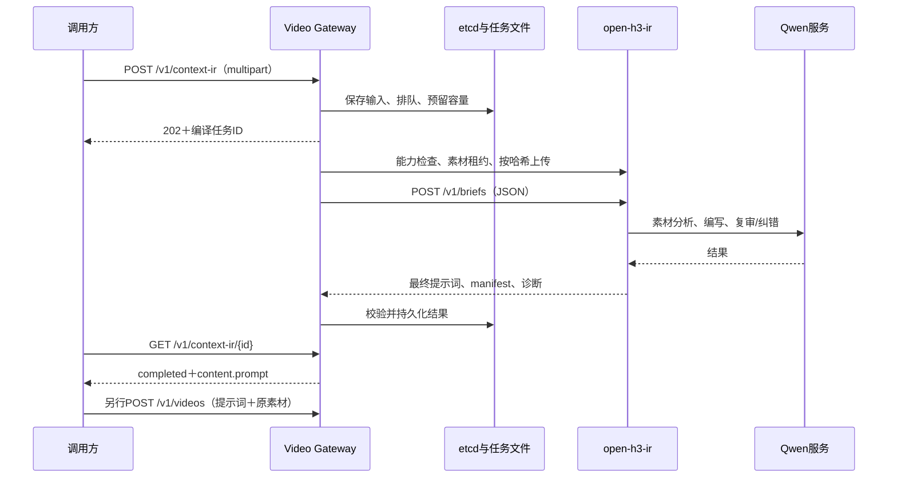

整理日期：2026-11-11。open-h3-ir基于已提交版本`037d793`；Gateway接口根据本地DingoRouter源码核对。部署参数以2026-11-06配置及2026-11-10核对记录为依据，示例地址、资源和目录均为脱敏占位值。

关联阅读：[官方接口](01-minimax-official-context-ir.md) · [open-h3-ir介绍](02-open-h3-ir.md)。

## 1. 我们修改了什么

源码仓库：[DJSaa/open-h3-ir](https://github.com/DJSaa/open-h3-ir)，分支`dingo-base`。不是另训练一个ContextIR模型，而是在开源编译器上修复语义保护、格式和服务对接问题。

| 方向 | 已实施内容 | 解决的问题及边界 |
|---|---|---|
| 台词保护 | 从明确发言指令提取台词；保留原文、语言和标点；使用占位符恢复 | 降低丢台词、翻译台词和把说明读成对白的风险；已有结构化输入的提取仍有待覆盖场景 |
| 描述语言 | 描述采用英文；台词、歌词、画面文字保留原语言 | 不再把中文描述输出作为默认策略，英文描述不等于英文口播 |
| 对白格式 | 合并已识别的重复引导、拒绝嵌套对白；处理`responds` | 修复同一台词前重复生成说话人前缀 |
| v5漏检修复 | 识别同一说话引导之间夹着嘴唇动作说明的重复结构 | 实测失败样本已被校验拦住；不贪婪删除任意动作描述 |
| 对白时序 | 编译和复审提供原台词长度、语言、参考语速范围与目标总时长 | 估计仅作参考，不能覆盖用户明确的慢语速、停顿或固定时间 |
| 素材音频时长 | 明确音色源录音长度不等于目标对白长度 | 保留真实音频元数据，不以删掉元数据来规避差异 |
| 跨镜头续说 | 稳定维护整句/分段占位符，检查全文重复和空续说，约束连接标记位置 | 不把已说完的一句话继续安排在下个镜头重新说 |
| 独立纠错 | 每次纠错重新携带模式规范、原始要求、台词映射和音色绑定 | 纠错请求不依赖上一轮隐含聊天上下文；有上限，不无限重试 |
| 动作参考 | 增加并贯通`motion_reference`，优先保留显式角色 | 视频只借动作时，避免错误带入源人物或背景 |
| 结构修复 | 处理保留段说话编号、既有时间戳位置等确定性格式问题 | 不通过关闭规则把不合格输出当作成功 |
| Gateway素材协议 | 能力声明、上传素材租约、编译期间保护、配对音轨语义 | 避免上传、清理与编译之间的素材生命周期冲突 |

主要代码：`language.py`、`voice_binding.py`、`reference_roles.py`、`dialogue_schedule.py`、`prose.py`、`compile.py`、`repair.py`、`service.py`、`asset_leases.py`以及`prompts/dialogue_review.v5.txt`。

最新修复提交为[037d793](https://github.com/DJSaa/open-h3-ir/commit/037d7933c2a4fe4765a576c5cea1ba2e12cfbb37)，前序Gateway素材及对白强化提交为[bbeddca](https://github.com/DJSaa/open-h3-ir/commit/bbeddca46d0238100a1b4f418a2778b7311be6a5)。1129项本地测试和23项官方样例检查通过；视频样本改善不能外推为所有输入或seed都不会乱说话。

## 2. Gateway对接做了什么



新增的服务边界包括：

1. **统一素材入口**：复用视频接口的multipart解析、媒体与尺寸校验；原始素材和编译证据持久化，不依赖长HTTP连接保存状态。
2. **按模型路由**：`model_bindings`把公开模型名映射到编译后端。不同模型可以配置不同后端，但当前语义适配实现仍是MiniMax-H3，不能仅加一个新模型名就宣称支持其它模型。
3. **异步任务管理**：复用公共etcd事务、租约、幂等、文件操作和监控基础设施，另建ContextIR任务状态及专用存储域，不与视频任务混用。
4. **共享容量**：每个后端的执行槽在同一任务域的多个Gateway之间共享；通过etcd CAS竞争，超过执行槽的任务排队，队列满则拒绝。
5. **结果契约校验**：检查`ready/written`、非空提示词、模式、帧数、画布、素材标签/哈希/角色及配对音轨策略。拒绝降级或错绑结果。
6. **失败与恢复**：准备阶段允许有限尝试；编译调用一旦已发出，不因结果不明就盲目再次执行。无法确认执行结束时保留物理槽并隔离后端，防止超卖容量。
7. **诊断与清理**：保存实际发给编译器的JSON、响应和时序数据；按保留时间清理，并通过指标展示排队、执行槽和隔离状态。

上游素材协议使用`GET /v1/capabilities`确认能力，`PUT /v1/asset-leases/{token}`预留本次素材，`PUT /v1/assets/{sha256}`上传，`POST /v1/briefs`编译，最后`DELETE /v1/asset-leases/{token}`释放。租约当前保存在编译进程内存中；若扩成多个ContextIR实例，需保证同一次尝试的这些调用命中同一实例，或先实现共享租约/一致路由，不能仅增加Service副本和共享PVC就认为支持多实例。

`max_inflight`限制编译任务数量，不等于vLLM的`max_num_seqs`，也不等于素材分析并行度。两者配置为32只是当前部署选择，每个编译任务内部仍可能有多次Qwen调用。

## 3. Gateway新增接口

| 方法与路径 | 作用 | 常见成功响应 |
|---|---|---|
| `POST /v1/context-ir` | 提交编译任务 | 新任务202；幂等命中200 |
| `GET /v1/context-ir/{task_id}` | 查询任务及成功结果 | 200 |
| `DELETE /v1/context-ir/{task_id}` | 取消未完成任务；删除已终止结果 | 取消返回200；删除返回204 |
| `GET /v1/context-ir/{task_id}/diagnostics` | 查询阶段耗时、角色及上游规则码 | 200 |

提交采用`multipart/form-data`，素材字段为重复的`input_references`，顺序有意义。当前没有新增通用的Gateway素材上传/下载API；不能假设编译任务ID能直接替代视频生成的素材。

这些路径不等价于官方`/v2/h3_context_ir`，也不等价于open-h3-ir的同步`/v1/briefs`。当前接口模块没有独立的新增Bearer鉴权实现，外部访问权限需沿用部署入口的认证授权；不要把内部principal字段视为已实现多租户安全隔离。

### 提交字段

| 字段 | 说明 |
|---|---|
| `model`、`prompt` | 必填；模型必须配置ContextIR绑定，提示词不能为空 |
| `seconds`或`num_frames` | 目标时长/帧数，复用H3适配器校验，不应同时传入矛盾值 |
| `size`或`width`＋`height` | 基础生成画布，按视频适配器规则校验；当前编译接口拒绝超分请求 |
| `input_references` | 按顺序上传图片、视频、音频；也可以无附件 |
| `reference_options` | JSON数组，每项以从0开始的全局上传`index`指定用途；可带`role`、`note`、`soundtrack_policy` |
| `creativity` | `restrained/balanced/bold/extreme`，默认`balanced` |
| `context_ir_seed` | 编译随机种子，默认7；与视频生成`seed`不同 |
| `dialogue` | 可选JSON数组，项为`text`及可选`language`、`speaker` |
| `silent` | 可选`true/false`，默认false；作为编译意图参与规范与校验 |
| `Idempotency-Key` | 可选请求头；重试同一业务请求时复用，同键不同内容返回冲突 |

未知参数会被拒绝。视频生成参数`seed`、`num_inference_steps`、`generate_sound`不是编译接口字段；当前也没有官方接口那样的`callback_url`字段或ContextIR任务列表路由。

### 素材用途

| 工作流/素材 | Gateway允许角色 |
|---|---|
| FL2VA图片 | `frame_anchor_first`、`frame_anchor_last`，按上传顺序表达首/尾帧 |
| Ref2VA图片 | `subject`、`environment`、`style` |
| Ref2VA视频 | `edit_source`、`motion_reference` |
| Ref2VA音频 | `voice_timbre`、`bgm`，需要明确指定 |

视频自身包含音轨时，必须明确`preserve`或`ignore`。Gateway会提取配对音轨并验证编译输出对音轨的处理；它不能被当作随意多出的一段独立音频。图片/视频/音频标签与全局上传index不是同一编号体系，调用方应保持上传顺序与提示词引用一致。

### 最小调用示例

下面以一张人物图和一段音色参考为例。地址和文件名为占位值；实际鉴权头按部署入口要求添加。示例只做编译，读取成功结果后才另行生成。

```bash
export GATEWAY_URL='https://gateway.example.com'
curl -sS "${GATEWAY_URL}/v1/context-ir" \
  -H 'Idempotency-Key: context-ir-example-001' \
  -F 'model=minimax-h3-ref2va' \
  --form-string 'prompt=图1中的人物面对镜头，用音频1的音色说一次：“准备好了，现在开始。”说完闭嘴微笑。' \
  -F 'seconds=5' -F 'size=1344x768' -F 'context_ir_seed=7' \
  --form-string 'reference_options=[{"index":1,"role":"voice_timbre"}]' \
  -F 'input_references=@person.png' \
  -F 'input_references=@voice.wav'

# TASK_ID填创建响应的id；未完成时继续查询，不重复创建新任务
curl -sS "${GATEWAY_URL}/v1/context-ir/${TASK_ID}" -o result.json
curl -sS "${GATEWAY_URL}/v1/context-ir/${TASK_ID}/diagnostics"
```

成功结果的主要字段如下（节选示意，提示词内容已省略）：

```json
{
  "id": "context-ir-<task-id>",
  "object": "context_ir",
  "model": "minimax-h3-ref2va",
  "status": "completed",
  "phase": "finished",
  "content": {"prompt": "<compiled H3 prompt>"},
  "generation_parameters": {"size": "1344x768", "fps": 24, "seconds": 5},
  "target": {"frames": 124, "fps": 24},
  "references": [],
  "warnings": []
}
```

实际有素材的响应会填充`references`，包括输入index、类型、哈希和模型标签。`target.frames`体现帧网格对齐，可能与名义秒数×fps不同；示例5秒对应124帧。生成时应保留返回的`generation_parameters`语义，不自行改成另一套尺寸/帧数。

读取到`completed`后：取`content.prompt`，携带相同原始素材及顺序，另行调用`POST /v1/videos`，再设置生成用的`seed`和`num_inference_steps`。编译seed不透传为生成seed；一次编译结果可以用不同生成seed做对照。编译成功本身不会占用视频Worker生成槽。

### 状态、取消与错误

任务状态包括`queued`、`in_progress`、`completed`、`failed`、`cancelled`、`expired`。`phase`提供准备、上传、编译等内部阶段；状态成功与业务内容符合预期是不同判断。

- 400：字段、角色、素材策略或尺寸等输入错误。
- 409：同幂等键对应不同请求。
- 408：上传超时。
- 429：编译等待队列已满。
- 503：服务不可接收、存储繁忙、存储预算耗尽或后端隔离等。
- 404：任务不存在；410：结果已过期。

取消运行中任务不代表底层同步编译已经停止，也不会立即释放仍在占用的物理槽。提交后连接丢失应优先使用相同幂等键或既有任务ID恢复查询，不另发不同键重复任务。

诊断接口提供`metrics`、`error`、素材角色和上游规则码，不把全部内部提示词、文件路径和原始异常默认暴露给普通查询响应。

## 4. 部署与配置

已验证部署是两个容器同Pod：open-h3-ir CPU服务＋Qwen3.6-27B推理服务。Gateway经稳定Service地址调用编译器。新镜像已包含修复，无额外源码覆盖挂载；早期独立CPU服务用于快速补丁与压测，后来已停用。

部署示例（地址、命名均为占位值）：

```yaml
context_ir:
  enabled: true
  backends:
    h3-ir:
      url: http://context-ir:8420
      adapter: open_h3_ir
      epoch: deployment-v1
      max_inflight: 32
      queue_limit: 32
  model_bindings:
    minimax-h3: h3-ir
    minimax-h3-ref2va: h3-ir
```

**默认值与部署值分开看：** 2026-11-11读取的本地Gateway源码默认`enabled=false`、`max_inflight=2`；测试部署显式开启并配置32。此前曾准备默认32的本地修改，但当前源码不是该默认值，不应仅依赖聊天记录。当前连接池代码为总64、单地址32；它也是独立于执行槽的限制，后续并发扩展需统一检查。

当前已验证的Qwen参数为TP=2、`max_num_seqs=32`、MTP3、`max_num_batched_tokens=12288`。这些是模型部署参数，不属于ContextIR请求字段。素材分析仍串行；分析并行2/4及32大请求并发只是独立压测，不在当前镜像中默认启用。

后端容量配置的revision会保存在etcd。修改`max_inflight`不能只改YAML：需在无在途任务的维护流程中同步后端记录，保证多个Gateway配置一致，再让新进程加载；无需重启etcd。运行中取消/未知执行不得直接删槽。我们本次2→32已完成同步和指标验证。

默认保留与超时（均可按配置调整）：排队600秒、准备120秒、编译600秒、整个执行900秒；输入终态保留1小时，结果保留24小时。超过保留期由清理流程处理，结果不应被当作永久业务数据库。

文件位于`<artifact-root>/_context_ir/<deployment-id>/tasks/<task-id>/`，保存规范化请求、原素材清单、路由快照、每次尝试的实际上游请求/响应及结果。多个Gateway接管任务时需要共享可读的制品存储和一致任务域。

监控包括提交/终态计数、`dingo_context_ir_inflight`、`dingo_context_ir_max_inflight`、`dingo_context_ir_queued`、`dingo_context_ir_quarantined`以及各阶段耗时。

## 5. 已验证与仍待验证

- 新镜像经Gateway的小用例编译→生成→下载/解码链路通过；其中单人音色用例仍出现绑定未解析警告，不能宣称音色已完全符合参考。
- R04修复后样本的台词转写改善，但此前也出现重复编译后回归；没有承诺所有输入都不乱说话。
- 当前新测试集已准备48条请求及6个校验样本，尚未全量执行。测试用途与实现能力须分开写。
- 素材大请求及并行实验的性能结论有固定输入、缓存和模型配置条件，不能直接推断不同素材或Gateway端到端32并发都安全。

后续质量计划与素材维护在独立ContextIR测试项目的 `context-ir-test/compiler-quality-suite-20261110/` 中，入口为该目录的 `README.md`；测试素材不随本源码仓库发布。

## 6. 源码核对入口

- 编译器：`open-h3-ir/h3ir/`，固定版本`037d793`；[分支说明](https://github.com/DJSaa/open-h3-ir/blob/037d7933c2a4fe4765a576c5cea1ba2e12cfbb37/docs/dingo-base.md)、[调用说明](https://github.com/DJSaa/open-h3-ir/blob/037d7933c2a4fe4765a576c5cea1ba2e12cfbb37/docs/calling-the-api.md)。
- Gateway：API路由：`dingo/video_gateway/context_ir/api.py`、字段校验：`dingo/video_gateway/context_ir/validation.py`、上游协议：`dingo/video_gateway/context_ir/protocol.py`、任务存储：`dingo/video_gateway/context_ir/task_store.py`、默认配置：`dingo/video_gateway/context_ir/config.py`。
- Gateway源码核对时HEAD为`af4b80e50`；本文根据当前工作区文件描述，不把未提交工作区内容自动等同于该提交的全部内容。

本文不包含集群地址、节点、namespace、内部镜像仓库地址或凭据。部署时由环境维护方提供实际参数。


## 近期实验修复的启用边界

2026-11-12的open-h3-ir源码增加了原文要求复审与专业H3输入局部修复：
`H3IR_REQUIREMENTS_REVIEW`、`H3IR_PROFESSIONAL_REPAIR`默认均关闭。
前者用于原文证据提取和有界纠错；后者让可靠识别的专业H3文档绕过全文扩写，
只做检查和必要的局部修改。普通输入仍走原有编译路径。

两项功能目前只在独立测试服务验证，不表示现有Gateway后端已默认开启。
当前复审拒绝返回HTTP502；Gateway会将其按执行结果不明处理，并可能隔离该编译后端。
这一错误分类衔接尚需统一，不能把“模型认为质量不合格”和“无法确认上游是否仍在执行”
当成同一情况。实验开关、返回诊断及限制以open-h3-ir源码的 `docs/calling-the-api.md` 为准。
