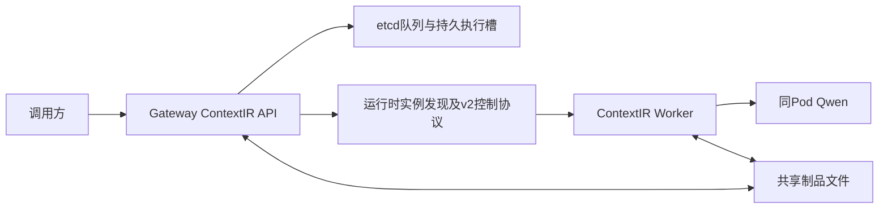

实现与验证日期：2026-11-14。本文描述Worker传输模式。Worker传输沿用现有任务接口；2026-11-15公开结果隐藏内部像素画布，当前字段以[API参考](05-api-reference.md)为准。现有HTTP后端仍可配置，HTTP素材协议见[Gateway接口与HTTP对接](03-customizations-and-gateway-api.md)。所有部署标识和地址均为占位值。

## 请求链路



Gateway保存上传素材与不可变请求，领取任务时原子占用物理槽位。控制消息只携带身份、摘要和共享文件描述符；图片、视频及完整编译结果不经控制消息内联传输。Worker复用`h3ir.engine.compile_request`，与原HTTP入口共用素材校验、编译和结果语义。编译结束后，调用方仍需另行提交`POST /v1/videos`。

公共代码包括运行时注册缓存、容量选择、记录读写和CAS事务。视频保留v1协议及原detached执行器；ContextIR使用v2执行管理器。当前没有把视频整体迁移到新执行器。

编译按比例和素材语义处理，不检查超分能力，不对外返回像素画布。参数与生成衔接见[ContextIR API参考](05-api-reference.md)。

## Gateway配置

在现有视频模型池之外配置`context_ir`，不要把编译Worker添加成视频推理池。下面两个模型名必须已存在于视频池配置。

```yaml
context_ir:
  enabled: true
  backends:
    h3-compiler:
      transport: worker
      worker_pool: h3-compiler-workers
      backend_target: dyn://example-compiler.compiler.compile
      storage_id: shared-artifacts-v1
      worker_capacity: 16
      max_inflight: 16
      adapter: open_h3_ir
      epoch: worker-v2
      queue_limit: 32
      queue_timeout_s: 600
      execution_timeout_s: 900
  model_bindings:
    h3-video: h3-compiler
    h3-reference-video: h3-compiler
```

`worker_capacity`是每个独立容量域的配置上限，取该值和Worker声明容量的较小值。Worker模式通过发现的物理槽执行调度，不用HTTP模式的`max_inflight`作为整个池的总容量；该字段仍保留在后端配置及兼容指标中。两个模型别名、多个Gateway共享槽位，不分别复制配额。健康实例满载时可以排队；没有健康编译实例时新请求返回503。

不写`transport`时默认HTTP模式，仍要求`url`。Worker模式要求`worker_pool/backend_target/storage_id`并禁止`url`。切换传输方式使用新的后端ID及模型绑定，保留旧后端配置，避免存量任务的路由快照失效。

## Worker与Qwen同Pod部署

编译容器启动命令：

```bash
python3 -m dingo.context_ir.worker
```

| 编译容器变量 | 示例或含义 |
|---|---|
| `CONTEXT_IR_ENDPOINT` | `example-compiler.compiler.compile`，对应Gateway的`dyn://`目标 |
| `CONTEXT_IR_POOL` | `h3-compiler-workers` |
| `CONTEXT_IR_DEPLOYMENT_ID` | 与Gateway相同的部署ID |
| `CONTEXT_IR_ARTIFACT_ROOT` | 与Gateway ContextIR制品根目录指向同一共享存储及相同子目录 |
| `CONTEXT_IR_STORAGE_ID` | 与Gateway配置相同的存储域标识 |
| `CONTEXT_IR_CAPACITY_DOMAIN` | 一套独立Qwen计算资源的容量域标识；同一Qwen仍可能执行旧请求时必须沿用，独立Qwen实例之间必须不同，详见下节 |
| `CONTEXT_IR_CAPACITY` | 默认16；当前部署显式16，预取固定0 |
| `CONTEXT_IR_HEALTH_PORT` | 默认8126 |
| `ETCD_ENDPOINTS` | 与Gateway使用同一发现后端 |
| `ETCD_LEASE_TTL` | 当前显式30秒；不是任务执行超时 |
| `H3IR_LLM_URL` | `http://127.0.0.1:8000/v1` |
| `H3IR_LLM_MODEL` | Qwen的served model name |
| `H3IR_STATE_DIR` | 本实例独占的持久缓存目录；不同Worker不得共用同一缓存目录 |

编译容器只申请CPU和内存，建议起点requests为4核/4Gi、limits为8核/8Gi；GPU由同Pod的Qwen容器申请。当前验证的Qwen为27B、TP=2、MTP=3、`max_num_seqs=32`、`max_num_batched_tokens=12288`。32个模型序列与16个编译任务是不同的限制；一个编译任务可以调用多次Qwen。

编译容器配置`GET /health`为存活检查、`GET /ready`为就绪检查。ready同时检查Qwen健康、恢复闸门与drain；满载本身不令实例不健康。drain后仍可读取已接收任务状态。Qwen未就绪或恢复状态不明时不派发新任务。

扩容需要新增完整的Worker＋独立Qwen组合，分配新的容量域和独占缓存目录，使用相同编译endpoint、pool和共享制品根目录。新实例就绪并注册后由Gateway自动发现；两个独立16槽实例在健康且无占用时提供最多32个执行槽。实例和容量域的配置规则见下节；同池多实例扩容的验证边界见“验证范围”。

## 实例身份、容量域与单模型多实例

本节按2026-11-17的实现核对。Worker模式支持同一模型部署多个独立Worker＋Qwen组合，由同一个编译池处理同类请求。调用方继续使用同一个`model`；Gateway的`context_ir.model_bindings`将该模型映射到编译后端，`backend_target`发现其下的所有运行时实例，无需逐个填写Pod地址。

### 三种标识

| 标识 | 产生方式 | 用途 |
|---|---|---|
| Worker池：`CONTEXT_IR_POOL` | 部署配置，须匹配Gateway的`worker_pool` | 将处理同类任务的实例归入同一调度池 |
| `instance_id` | Worker使用Dynamo Runtime的`endpoint.connection_id()`自动取得 | 定向派发、查询和取消某个Worker进程的任务；不提供同名环境变量供调用方设置 |
| 容量域：`CONTEXT_IR_CAPACITY_DOMAIN` | 部署方显式提供，当前无自动缺省值 | 标识Worker背后的一套独立Qwen计算资源，用于执行槽、占用和故障恢复 |

`instance_id`标识当前注册进程，重启后不能依赖它保持不变。容量域标识所使用的后端资源；同一套仍可能处理旧请求的Qwen，不能因CPU编译进程重启就更换容量域。两个独立Qwen实例即使模型名称和权重相同，也必须使用不同容量域。

例如，同一个编译池有两套独立的双卡Qwen：

```text
h3-compiler-workers
├─ instance A → capacity_domain=qwen36-pod-a → 独立Qwen A（2 GPU）
└─ instance B → capacity_domain=qwen36-pod-b → 独立Qwen B（2 GPU）
```

Gateway从服务发现获取实例列表，查询各实例能力，并校验存储标识、协议、适配器和可接单状态。之后依据空闲槽位比例选择候选实例，对等候选轮转；真正领取执行槽还须通过etcd比较并交换事务。新实例健康且有空闲槽后即可参与派发，原有模型绑定和编译服务地址不必改变。

每个容量域的上限取Worker声明值与Gateway的`worker_capacity`较小者。增加实例扩展独立执行容量，`queue_limit`仍是对应编译后端的排队上限，不随副本数自动倍增。多个公开模型别名映射到同一个编译后端时共享这套队列和执行容量。

### 容量域冲突如何处理

`capacity_domain`不是根据`H3IR_LLM_URL`、模型名称或GPU设备自动探测出来的。它依赖部署方正确描述资源关系，不会主动验证两个不同域是否实际指向同一个Qwen。

- 同一注册实例经多个逻辑别名出现时，容量不会重复计入。
- 同一容量域出现不同`instance_id`或进程代次，或仍有其他注册留下的占用时，调度器会阻止该域派发，直到冲突和占用被协调清理；不会把它们的容量相加，也不是随机选择其中一个。
- Worker启动时还会对共享制品目录下的容量域锁文件取得排他进程锁。两个活跃编译进程在相同存储和部署ID下使用相同容量域，后启动者会因锁冲突拒绝启动。

因此，不能通过给同一个Qwen换两个容量域来扩大容量，这会绕过上述去重关系。当前恢复策略要求一个活跃编译Worker独占一套Qwen；需要更多容量时部署新的独立Qwen组合。

### Kubernetes副本配置

只把固定`CONTEXT_IR_CAPACITY_DOMAIN`的Deployment改成`replicas: 2`不够。两个完整Pod各自运行独立Qwen时，容量域和`H3IR_STATE_DIR`也应按Pod隔离。可使用Downward API，以下是编译容器的环境变量片段：

```yaml
env:
- name: POD_UID
  valueFrom:
    fieldRef:
      fieldPath: metadata.uid
- name: CONTEXT_IR_CAPACITY_DOMAIN
  value: qwen36-$(POD_UID)
- name: H3IR_STATE_DIR
  value: /compiler-state/$(POD_UID)
```

`POD_UID`须先于引用它的变量声明；`/compiler-state`需挂载可写存储。所有副本继续使用相同的`CONTEXT_IR_ENDPOINT`、`CONTEXT_IR_POOL`、`CONTEXT_IR_DEPLOYMENT_ID`、`CONTEXT_IR_STORAGE_ID`及指向同一共享存储的`CONTEXT_IR_ARTIFACT_ROOT`。每个编译容器的`H3IR_LLM_URL`仍指向本Pod的Qwen，Qwen自身按所需卡数申请GPU；调度按部署环境的弹性资源规则配置。

该方式适用于整个Worker＋Qwen随Pod一起替换：同Pod容器重启时UID不变，新建Pod及其独立Qwen获得新UID。若CPU Worker独立部署、Qwen跨CPU Pod重建仍持续存在，应使用与那套Qwen绑定的稳定容量域，不能直接以CPU Pod UID标识资源。新Pod获得新域不代表旧域的任务或槽位已结清；发现租约过期也不允许盲目释放旧占用。

## 取消、故障与用量

- 排队取消不调用Qwen。执行中取消设置持久标记，在后续调用边界停止；正在进行的模型HTTP调用不能保证立即中止，因此公开`cancelled`不代表物理槽已释放。
- Gateway重启后接管原attempt，读取Worker落盘结果，不重新编译。
- CPU Worker异常终止但Qwen仍运行时，恢复阶段停止接单，确认专属Qwen的running和waiting连续两次为0后再处理未知执行。无法恢复完整结果的任务明确失败为`context_ir_execution_unknown`，不自动重复计费编译。
- 占槽和attempt不随发现租约过期自动删除；未知事务结果先读回，不能盲目重发或释放槽位。
- 每次实际LLM调用先保存意图，再保存上游usage回执。现有`usage`汇总文本及视觉调用、多轮纠错与缓存用量；视觉token由Qwen的`prompt_tokens`报告，不自行估算。回执缺失时`complete=false`，未知缓存为`null`。
- 共享输入、Worker尝试目录和用量记录按原保留期清理。物理执行未结清前不回收素材；结清后按实际文件字节缩减最大准备预算，避免历史完成任务长期占满逻辑预算。

## 运维与回退

1. 查看Gateway编译任务、诊断、Worker ready和发现能力。确认声明容量16、预取0、`accepting=true`，不要只看Pod Running。
2. 维护时先停止新任务路由或对目标Worker发送受控的私有`drain`，等待活动任务及物理槽归零，再终止进程。Kubernetes终止宽限应覆盖最长编译或已确认的取消收尾。
3. 仅更新编译容器代码时可以单独重启该CPU容器，避免反复加载Qwen；修改Pod模板会滚动替换整个Pod。
4. 需要回退时先把新任务绑定切回有健康实例的HTTP后端，保留能识别v2的Gateway直至Worker任务全部结清；之后再回退二进制。只改回URL而没有恢复HTTP服务不可用。

## 验证范围

本地Gateway/Worker相关220项测试通过；编译器1272项通过、11项跳过，官方格式控制23/23通过。真实测试覆盖完整126项编译集、1/16/32请求、双Gateway共享16槽、排队及执行中取消、drain、CPU Worker故障、Gateway接管，以及T2VA/FL2VA/Ref2VA三类768P视频链路。

126项首轮为116项正常技术完成、1项预期拒绝、4项负向未满足预期、5项HTTP失败。存储预算问题修复后3项完成；两项首尾帧输入调整为满足原有比例校验的画布后完成，保留原始失败记录。技术完成不代表所有提示词已完成语义人工评分。真实etcd整体停机、同一模型同一池的多Qwen扩容与新一轮超分视频不在该轮实测范围内。2026-11-17补充的Qwen3.6与Qwen3.8对照部署属于两个独立编译后端，不能替代同一池双实例扩容验证。

## 输入意图解析与独立CPU验证（2026-11-16）

新增`protocol_adapters.intent_resolution=1`能力。带新版输入意图契约的任务仅分配给声明该能力的编译Worker；HTTP兼容后端使用`gateway_contract.intent_resolution=1`声明同一能力。旧持久任务仍按原契约恢复，新任务不能静默发给旧后端。

阶段结果按输入指纹保存，可在同一attempt恢复时复用，避免重复调用和重复用量。原始上传index/哈希、显式锁定角色、最终模式/画布/标签及配对音轨仍须经过Gateway契约校验。

本轮快速验证使用独立CPU编译Worker连接既有Qwen，只切换测试Gateway的新任务绑定；Qwen与视频Worker未重启。可将编译容器与Qwen同Pod部署，也可在受控测试中分离；多个活跃编译进程共享同一Qwen时仍不得重复计入容量。更新Pod模板会替换整个Pod，单独新增CPU Worker和新路由可避免这种重载。此次采用源码补丁，尚未重新构建镜像。

## 测试部署收敛为单Pod（2026-11-16）

随后将最新补丁合回与Qwen同Pod的编译容器，Gateway恢复主Worker后端，并回收独立CPU验证部署。首次配置持久PYTHONPATH入口需要一次Pod更新；以后CPU代码变更先原子切换共享存储中的版本化源码入口，确认任务排空后只重启编译容器。不要为仅CPU代码更新反复修改整个Pod模板；也不要在同一Qwen上长期并存多个活跃编译容量域。实际环境路径不写入本文。


## 容量观测

Worker 模式按能力握手与物理容量域分配槽位。每个实例的容量取上报值与 `worker_capacity` 的较小值；同一物理域的别名不会重复计入。`max_inflight` 用于 HTTP 后端的配置限制，不能当作 Worker 模式的动态总容量。

| 指标 | 含义 |
|---|---|
| `dingo_context_ir_queue_limit` | 后端排队上限 |
| `dingo_context_ir_queued` | 尚未领取执行槽位的排队任务数 |
| `dingo_context_ir_available_execution_slots` | 当前可供调度的空闲槽位；Worker 模式扣除占用并过滤过期能力 |
| `dingo_context_ir_inflight` | 已领取且尚未释放的执行槽位数，含取消后仍在收尾的任务 |

上述指标按 `backend` 区分。只观察公开模型绑定的后端，不将未使用的兼容后端配置相加。HTTP 模式的可用槽位为配置上限减去占用，不代表远端健康探测结果。
