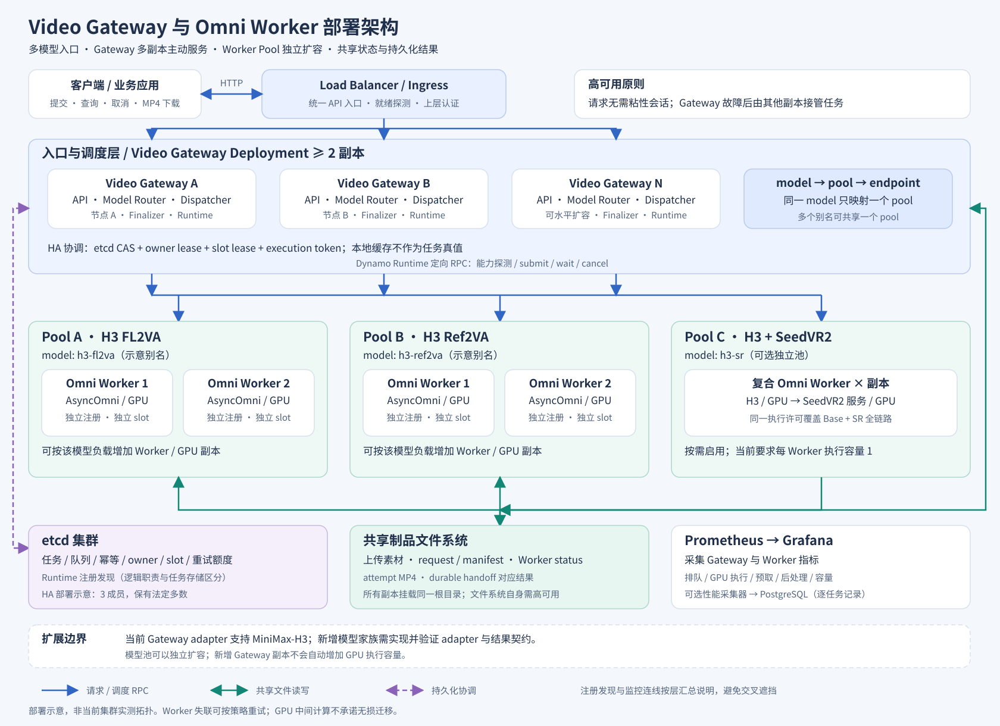
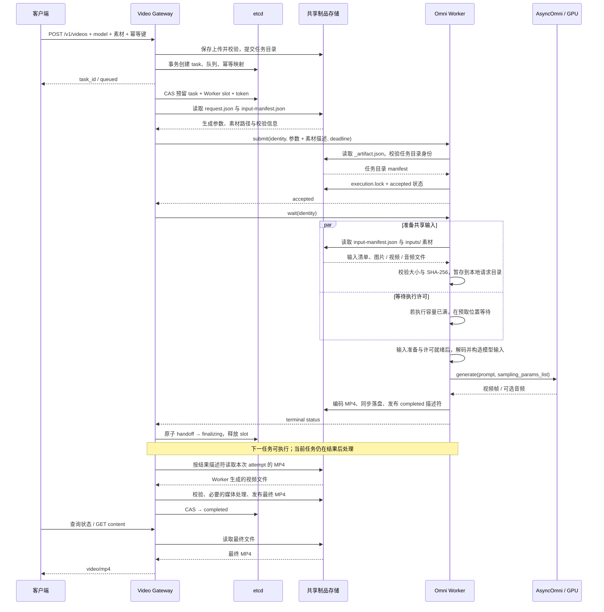
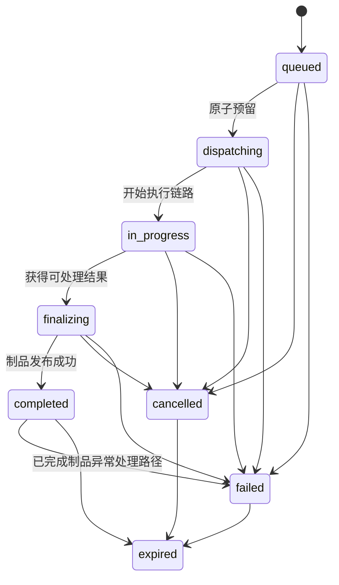

Video Gateway 将耗时较长的视频生成转换为可持久化、可查询、可取消的任务；Omni Worker 负责输入转换、vLLM-Omni 引擎执行、视频编码及执行结果落盘。二者通过 Dynamo Runtime 定向调用和共享制品目录协作，etcd 保存任务与调度归属。

本文面向开发、架构评审和部署维护人员，以当前仓库 `dingo/video_gateway/`、`dingo/vllm/omni/` 的实现为准，重点描述 MiniMax-H3 视频服务及可选 SeedVR2 超分链路。配置默认值来自当前代码；部署可以覆盖。Worker 的通用图片、音频、实时及拆分 stage 模式只说明边界，不将其视为 Video Gateway 已支持的模型。

## 部署架构



独立文件：[SVG 部署架构图](../assets/img/video-gateway-omni-deployment.svg)、[高清 PNG](../assets/img/video-gateway-omni-deployment.png)、[可编辑 Mermaid 源文件](../assets/img/video-gateway-omni-deployment.mmd)。图中的副本数和节点划分是部署示意，不代表当前环境的实际集群拓扑。

### 服务边界

| 组件 | 责任 | 持久化或运行状态 |
|---|---|---|
| 入口负载均衡／Ingress | 分发 HTTP 请求、移除未就绪副本；上层可提供认证与业务配额 | 入口配置 |
| Video Gateway | HTTP 协议、模型路由、媒体校验、幂等、队列、slot 预留、结果发布及清理 | etcd 与共享制品；本地保留缓存、运行协程及内存预算 |
| Dynamo Runtime | Worker 注册发现、endpoint 通信、指定实例调用 | 注册发现信息；每进程的发现视图 |
| Omni Worker | 执行容量控制、请求转换、引擎调用、编码、执行状态持久化 | 模型及 GPU 状态、进程内任务、共享 attempt 文件 |
| etcd | 任务真值、队列及索引、幂等映射、owner 与 slot 协调、重试记账 | 小型元数据，不保存视频字节 |
| 共享制品存储 | 上传素材、请求清单、Worker 状态及结果、最终 MP4 | Gateway 与 Worker 可访问的同一文件系统 |
| 可选 SeedVR2 服务 | 对 H3 Base 视频进行超分 | 由复合 Worker 管理的子进程、执行 journal 与输出 |
| Prometheus／Grafana | 聚合服务指标与展示 | 监控系统自己的时序数据 |

Runtime 是嵌入各进程的通信基础设施，不要求部署一个额外的统一推理 Router。Gateway 先选择具体 Worker 和 slot，再通过 `client.direct(instance_id=...)` 下发请求。

### 多模型路由与独立扩容

配置中的 `pools` 是路由与调度单元。每个 pool 包含 `pool_id`、对外 `served_models`、后端 `backend_model`、`backend_target`、`execution_mode`、adapter 和 scheduling。

```text
客户端 model
    → pools_by_model[model]
    → pool 的 adapter 归一化请求
    → backend_target 对应 endpoint 的实例集合
    → 能力筛选与 slot 预留
    → 指定 Worker 实例执行
```

一个 pool 可以承接多个对外模型别名；一个对外模型名只能映射到一个 pool，重复映射在配置加载时被拒绝。相同 endpoint 的多个 Worker 注册形成副本池；不同模型／工作流使用独立 endpoint 和 GPU 资源，可分别增加副本。

当前 Gateway 的 adapter 注册表只接受 `minimax_h3`，已实现 `fl2va`、`ref2va` 工作流及配置允许的超分 profile。因此，“支持多个模型”具体指多 served model、多 pool、多工作流／模型配置同时服务；接入新的模型家族还需实现 Gateway adapter、请求与结果契约及兼容性验证。通用 Omni Worker 能运行某个模型，并不自动意味着该模型已经可以通过此 Gateway 接入。

### 高可用成立条件

多个 Gateway 可以同时接收请求和竞争队列，无需固定 HTTP 会话粘性。任一副本都可读取任务状态和下载共享结果。任务执行归属由 etcd 事务决定，Gateway 的内存队列不是集群真值。

同一部署的副本必须指向同一逻辑 etcd key 空间、相同 `deployment_id`、兼容的 pool 配置与同一共享制品目录。Worker 的 detached task root 必须与 Gateway 的 artifact root 对齐。实际部署可将 Gateway 副本分布在不同节点，etcd 使用有法定多数的集群，共享文件系统也需要自身的可用性保障。

Gateway 多副本主要消除入口进程单点；它不能替代 etcd、入口负载均衡和共享文件系统的高可用。Worker GPU 中间计算没有通用的跨进程迁移能力，Worker 故障后的重试可能重新执行模型。

## 一次请求如何完成

独立图文件：[SVG 请求时序图](../assets/img/video-gateway-request-sequence.svg) · [Mermaid 源文件](../assets/img/video-gateway-request-sequence.mmd)。

下面描述带输入素材、启用 detached、共享文件输入（`shared_files_v1`）、二进制结果和 early release 的链路。RPC 携带生成参数与文件描述，Worker 从共享制品目录读取素材。



共享输入准备只负责读取、校验和本地暂存原始文件，可与执行许可等待重叠；媒体解码与模型输入转换在后续执行路径中完成。若配置为 inline 输入，则由 Gateway 读取素材并编码进 RPC payload，Worker 从 payload 解析素材，不走图中的共享输入读取分支。两种方式都使用共享目录保存 detached 执行状态和二进制结果。

异步提交默认返回 `202`，可通过 `http.async_submit_status_code` 调整。同步接口 `POST /v1/videos/sync` 使用同一任务机制，只是等待终态再返回 MP4；等待超时不删除已提交的任务，调用方可使用返回的任务标识继续查询。HTTP 请求结束与模型任务结束是不同生命周期。

## Video Gateway 内部设计

### 模块职责

| 模块 | 核心职责 |
|---|---|
| `__main__.py`、`app.py` | 读取配置、创建 Runtime／存储／adapter／dispatcher、启动 aiohttp 与关停流程 |
| `api.py`、`form_parser.py` | HTTP 路由、multipart 解析、请求体限制、状态／下载／取消、可选代理 |
| `service.py` | 模型选择、请求归一化、幂等摘要、种子默认值、制品目录提交与任务创建 |
| `dispatcher.py` | 发现、slot 调度、任务监视、取消、Worker 失联处理、owner 接管和清理 |
| `task_store.py`、`task_runtime/transactions.py` | 存储抽象、etcd CAS 事务、索引、lease 与重试计数 |
| `artifact_store.py`、`file_io.py` | 文件布局、上传心跳、制品校验和发布、异步文件操作边界 |
| `adapters/minimax_h3.py` | H3 请求校验、后端 payload、输出消费和媒体契约 |
| `result_handoff.py`、`finalization.py` | 持久化结果交接及独立后处理 |
| `memory_budget.py` | 按任务权重限制 Gateway 同时处理的媒体内存 |
| `telemetry.py`、`performance.py`、`performance_cache.py` | 聚合指标、逐任务计时、有限容量的性能记录 |

### 请求准入与幂等

提交先解析 model；未指定时使用 `http.default_model`，或在只有一个对外模型时自动选择。多模型且无默认模型时必须显式传 model。

上传文件先进入临时目录。adapter 检查字段、工作流、媒体内容、尺寸、时长和大小，并形成 normalized request 与输入 manifest。文件类型不能仅依据客户端 MIME 判断。编码输入大小、输出上限和内存预算分别约束不同阶段。

幂等作用域由 principal hash 和 `Idempotency-Key` hash 组成。key 长度为 1～256 字节；请求摘要包含 model、pool、配置 revision、归一化参数、输入顺序／大小／SHA-256／媒体类型及协议版本。相同 key 和相同摘要返回已有任务，不重新执行；相同 key 和不同摘要返回 `409 idempotency_conflict`。

内部的 shared-input 传输选择不改变客户端请求摘要。Gateway 为缺省 seed 生成的随机值也不参与原始请求摘要；默认 seed 在确定创建新任务后解析并持久化，派发和恢复复用该值。显式 seed 保留在请求语义中。未配置 Gateway seed 默认策略时，不凭空补造该策略。

幂等检查之后进行 Worker 可用性和队列准入。新任务先把上传目录提交为任务目录，写入 request 和 manifest，再由 Task Store 原子创建任务、队列项、计数及幂等映射。提交竞争仍由存储事务裁决，不能只依赖 HTTP 层预检查。文件系统与 etcd 之间没有跨系统事务，异常残留需要由生命周期清理处理。

### 持久化对象与执行身份

`VideoTask` 保存任务所属 deployment／pool、模型与配置 revision、输入路径、状态、截止时间、结果 metadata 和错误；`StoredTask.revision` 是并发更新的比较依据。

执行相关身份包括：

| 字段 | 用途 |
|---|---|
| `attempt` | 第几次实际派发；新任务为 0，首次预留后进入第 1 次执行 |
| `worker_instance_id` | Runtime 注册实例标识 |
| `worker_key` | 由 backend target、实例和 slot 定位资源 |
| `owner_generation` | 当前 Gateway 进程代际，区分旧进程和接管者 |
| `execution_token` | 本次执行的随机身份，隔离旧结果和迟到取消 |
| `deadline_at_ms` | 当前执行截止时间，包含 Worker 端等待等生命周期消耗 |

修改状态使用 CAS（比较后更新），对任务 revision 和必要的执行身份做比较。释放 slot 也必须匹配对应 task、owner generation 与 token。这样即使旧请求或旧 Gateway 晚到，也不能释放已被其他任务复用的 slot。

### 状态机



公开 API 将 `dispatching` 和 `finalizing` 映射为 `in_progress`。因此 `in_progress` 可能表示下发、Worker 排队、模型执行或结果后处理；不能直接解释为 GPU 正在运算。`progress` 当前只有完成时的 100 和其他状态的 0。

Worker 失联后的重新排队通过专用事务处理，不是任意状态回退：符合策略的首次 attempt 回到 queued，下一次预留产生新的执行身份。`expired` 是保留一段时间的墓碑状态，之后可删除任务记录；它与“结果文件已经清理”分别记账。

### 队列与调度

每个 pool 有独立队列与调度循环。Dispatcher 结合 Worker 注册列表、能力缓存、lease watch 和任务唤醒信号进行调度。无实例、无空闲 slot 或 lease 视图不健康时可以提前结束本轮，减少无效 etcd 查询。

正常任务按有序队列读取；启用一次 Worker 重试时优先考虑重试任务，但被原失败实例排除而无法运行的重试任务不会挡住其他可运行任务。候选 Worker 还需满足 SR profile、shared storage identity 和 workflow 等能力约束。

选中任务后先申请本进程内存预算，再轮转选择可用实例／slot。`reserve()` 原子验证任务版本、队列、slot 占用及重试记账，成功后移除队列项、更新任务与 deadline、生成 lease，并启动执行协程。竞争失败释放本地预算，重新调度。

队列上限是 pool 维度；内存预算和 finalizer 并发限制是 Gateway 进程维度。扩容 Gateway 不等于扩容模型执行能力，也会增加可同时进行的媒体处理总量。

### 容量协商与预取

Gateway 对物理 Worker 注册实例发起 `capabilities` 探测，执行容量取 Worker 声明与 Gateway 配置上限的较小值。普通旧 Worker 或探测失败只保守退回最多一个 slot，不能从配置推断多个 slot。需要复合 SR 能力时，探测失败不降级为普通可用 Worker。

预取要求双方支持 `execution_prefetch_v1`、容量声明一致，且 Gateway 开启 `early_release_slot`。Worker 的执行容量 N 和预取容量 P 分开：P 当前只能为 0 或 1，最多接纳 N+P 个任务，实际执行许可仍只有 N 个。

例如 N=1、P=1：任务 A 执行时任务 B 可被预先接受并准备输入；A 的 Worker 执行结束后 B 获得许可。Gateway 对 A 的结果校验和发布可与 B 执行重叠。预取不保证提升 GPU 吞吐，效果取决于输入准备、引擎串行约束及输出处理耗时。

### 内存与磁盘背压

传统 inline 输入会发生 base64 和 JSON 组装。提交阶段的保守估算为：

```text
任务估算内存 = 2 × 编码引用字节数
             + 最大结果的 base64 字节数
             + task_memory_overhead_bytes
```

默认进程内预算为 2 GiB、额外任务开销为 64 MiB、结果上限为 128 MiB。取得结果后可缩减预算到后处理所需权重。shared-input 和二进制输出可以减少实际复制，但不能将这份 Gateway 预算当作 GPU 显存预算或整个集群的内存上限。

制品存储有软／硬剩余容量水位：接近水位先触发清理，仍低于硬水位时拒绝新提交并返回 `507 insufficient_artifact_storage`。finalization pending 达到本 Gateway 对应 pool 的阈值时暂停新派发，已经接纳的任务仍可完成。

## Omni Worker 内部设计

### 启动与服务注册

入口为 `python -m dingo.vllm.omni`。启动过程解析 `OmniConfig`，创建 Runtime、endpoint 和 `OmniHandler`；`BaseOmniHandler` 根据模型、stage 配置、diffusion 参数和并行配置创建 `AsyncOmni`。

标准聚合模式以 `WorkerType.Aggregated` 注册模型：对 Gateway 来说一个 endpoint 承担完整 pipeline。非 leader 的 data parallel rank 不重复注册入口。`OmniEngineMonitor` 独立检查 AsyncOmni 引擎健康，防止 stage／rank 已死亡但 endpoint 仍长时间提供服务。

配置 `--detached-video-task-root` 后，入口由 `DetachedOmniTaskManager.generate` 包装；未启用时使用普通 `OmniHandler.generate`。可选包装顺序为：

```text
Runtime endpoint
  → DetachedOmniTaskManager
    → H3VideoHandler 或 SeedVR2Handler（按配置启用）
      → OmniHandler
        → MiniMax-H3 request adapter
        → AsyncOmni
        → OutputFormatter
```

`--stage-id`、`--omni-router` 和 realtime 是另外的启动分支。stage router 可转发 stage connector 引用并协调独立 stage Worker；它不等同于 Video Gateway 的持久化视频队列。

### 私有 detached 协议

请求使用 `_dingo_video_task` 信封，`schema_version=1`。身份为 deployment、pool、task、attempt、execution token；submit 另外携带 payload 和可选 deadline。协议校验标识符、token 和字段，不能以任意路径替代受控任务目录。

| 操作 | 作用 |
|---|---|
| `capabilities` | 声明执行／预取容量、accepting、wait、shared-input 和 SR 能力 |
| `submit` | 校验任务 manifest、去重、持久化 accepted，启动后台任务 |
| `wait` | 等待当前执行状态／终态，减少持续轮询 |
| `status`／`result` | 读取持久化 Worker 状态 |
| `cancel` | 请求指定执行身份停止 |

submit 的后台执行使用独立 context，不依附最初的 RPC 生命周期。Gateway 或 RPC 断开后，Worker 可以继续运行；重连或替代 Gateway 可以按同一身份查回状态。

去重有三层：进程内 `_running`、已落盘的终态、以 `O_CREAT | O_EXCL` 创建的 `execution.lock`。同一身份重复 submit 不新启一次模型调用。容量不足返回 `busy`，不写执行锁或伪装成已经运行。该机制不承诺跨 Worker 崩溃的“模型只执行一次”，因为故障重试会创建新的 attempt。

### 执行许可与输入处理

Manager 约束已接受任务数；预取路径用 semaphore 等待执行许可，并监视取消与 deadline。shared-input 准备可以和许可等待重叠；过期未进入执行的任务可返回 `worker_queue_timeout`。

Gateway 侧 adapter 负责面向业务的校验、尺寸规划与 payload 构造。Worker 侧 request adapter 负责将引用转换为模型需要的图像、音频／视频路径及条件结构，并生成 `EngineInputs`。二者职责不同，不能只修改其中一个就改变完整协议。

引用有两条路径：inline data URL；或显式启用 `shared_files_v1` 后传递共享文件描述。后者要求 Worker 宣告 `shared_input_files.v1`，storage ID 和 workflow 匹配，任务身份和文件校验通过。Worker 准备本次请求的媒体后释放原始大 payload 的引用，减少整个 diffusion 过程持续占用的内存。

### 引擎调用与视频编码

`OmniHandler` 识别视频请求，加载输入，构造 prompt 和每 stage 的 `sampling_params_list`，调用 `AsyncOmni.generate()`。模型内部如何调度 diffusion、attention、VAE 及多 GPU 并行由上游引擎和模型配置决定；Gateway 不逐步控制去噪。

输出由 `OutputFormatter` 根据类型处理。视频路径归一化帧，要求得到单个视频，在线程中调用编码器形成 H.264 视频和可选 AAC 音频的 MP4。编码等待、实际编码、协程恢复和制品写入分别计时。通用路径可返回 URL 或 base64；detached binary 路径直接写 attempt 目录并返回文件描述符。

`DINGO_VIDEO_BINARY_RESULTS=1` 启用二进制结果；`DINGO_VIDEO_INLINE_RESULT=1` 把小型终态结果直接写入 Worker status，省去额外 response JSONL 文件。这里的 inline 指结果元数据，不是把 MP4 字节放进 etcd。

## 共享文件与结果交接

### 文件布局

```text
artifact_root/
  _uploads/...                     上传临时区（具体位置由 ArtifactStore 管理）
  <deployment>/v1/pools/<pool>/tasks/<task>/
    _artifact.json                 任务目录身份与生命周期
    request.json                   归一化请求
    input-manifest.json            输入清单与摘要
    ...                            上传素材及最终发布制品
    attempts/<attempt>-<token>/
      execution.lock               此执行身份的排他创建标记
      worker-status.json           accepted/running/终态及心跳
      worker-response.jsonl         非 inline-result 路径使用
      cancel.requested             持久化取消信号
      ...mp4                       二进制执行结果
      base-checkpoint.json         可选 SR Base checkpoint
      sr-journal.json              可选 SR 执行 journal
```

Worker 拒绝带 symlink 的受控路径，并验证 `_artifact.json` 中的身份。状态写入使用临时文件、flush、文件 fsync 和 replace；MP4 writer 还同步目录后发布描述符。描述符包含受限文件名、大小、SHA-256 等信息，Gateway 在本次 attempt 目录内解析，不能直接信任任意绝对路径。

### durable handoff 为什么必要

Worker completed 只表示执行结果已经产出；公开任务 completed 表示 Gateway 已校验并发布可下载制品。两者之间可能发生文件检查、画幅处理、重封装、hash 检查或存储延迟。

启用 early release 后，Gateway 将 `_result_handoff_v1` 与 `finalizing` 状态持久化，并在同一事务中释放本次 slot 和相关重试额度。handoff 绑定 task／attempt／token，保存结果描述符、创建时间、后处理 deadline 和失败次数。成功提交以后才可将这份结果与 Worker 生命周期解耦。

独立 `ResultFinalizer` 处理结果，不再调用模型、不再依赖活 Worker、也不释放已经复用的 slot。暂时性存储错误可以按持久化失败次数退避重试；永久校验错误、重试耗尽或 deadline 到期只让当前结果处理失败。默认并发 4、pending 上限 64、超时 60 秒、最多额外重试 2 次，这些限制按 Gateway 配置生效。

handoff 事务超时不代表未提交。代码先读回任务核对身份和状态；确认已提交则继续 finalization，遇到 CAS 或暂时性存储故障则退避重读，不能直接重跑模型。无法可靠写入终态的内部错误会停止准入并请求进程重启，将恢复交给 owner 接管流程。

## 高可用与故障处理

### 三种不同的活性证据

| 证据 | 回答的问题 | 当前机制 |
|---|---|---|
| Gateway owner lease | 原调度进程是否仍拥有合法归属 | owner TTL 15 秒，约每 5 秒续期 |
| Worker slot heartbeat | 这份资源预留是否仍由原 owner 维护 | 每 5 秒心跳，连续 2 次失败停止本地执行链路；etcd execution lease 默认 15 秒 |
| Worker status／注册状态 | 已提交执行是否仍存活 | 状态约每 5 秒刷新，陈旧阈值 20 秒，结合发现及探测判断 |

逻辑 `owner_expires_at_ms` 不能替代原生 etcd 租约证据。接管 orphan active task 要求相关 heartbeat key 随 lease 消失后满足事务条件。时间参数相互耦合，不能独立缩短 TTL 而保持原有止损周期不变。

### Gateway 崩溃和恢复

替代 Gateway 从共享状态查找失去 owner 的 active task，CAS 取得新归属。detached 任务可以继续观察已有 Worker 状态和结果，无需因为入口崩溃就重新执行。已有 durable handoff 的 finalizing 任务可直接恢复结果处理，即使原 Worker 已不存在。

发现视图也可能失效。可选 discovery watchdog 对照 Runtime 视图与 etcd 注册真值判断持续不一致；Runtime 永久终止则退出进程，交由进程管理器重建，而不是让一个无法恢复发现的 Gateway 持续 Ready。

### Worker 故障和有限重试

`DINGO_VIDEO_WORKER_RETRY_ONCE=1` 为 detached 首次执行开启受限重试；默认关闭。只有符合失联／执行前不可用等明确条件的错误进入该路径，参数错误、媒体错误、OOM 和普通模型执行失败不无差别重试。

重试有共享 credit 账本；默认预算 32，等待超时 600 秒，原失败实例退避默认 30 秒。重试选择排除原失败实例，原 slot 必要时隔离到执行 deadline 加取消宽限。该机制避免多个 Gateway 分别认为自己拥有完整重试预算。

### 取消和 GPU 停止

DELETE queued 任务可直接结束排队；执行中的任务先记录取消意图，再通知对应 attempt／token 的 Worker。确认持久化 cancelled 后可以释放租约；超过 `abort_grace_s` 未确认时隔离旧 slot，不能立即假设资源已经空闲。finalizing 阶段的取消由 finalizer 按身份和 revision 处理。

引擎 abort 可能只结束外层结果传递，已经进入同步 diffusion forward 的 GPU 计算仍要等到可中断边界。因此成功 DELETE、公开 cancelled 和 `execution_started` 都不是 GPU 内核状态证明；Worker queue wait 也不包含引擎内部不透明的排队。

启用 H3 recovery 包装时，取消增加各 rank 的 `synchronize_device` 收尾确认，等待期间保留执行约束并暂停准入，无法确认收尾时隔离 Worker。该增强能力需要对应配置，不能推广为所有 Omni Worker 的默认行为。

### OOM 与进程恢复

基础 H3 recovery 由 `DINGO_VIDEO_H3_RECOVERY=1` 启用，要求 H3 adapter 和执行容量 1。复合 SR Worker 同样要求执行容量 1。相关 handler 将明确 OOM 分类为 `resource_exhausted` 并隔离进程，不通过追加一次推理“试运行”复用出错引擎。

`CompositeWorkerRecovery` 停止准入、尽量完成终态持久化、注销 endpoint、清理受管 SR 进程，最后退出；外部进程管理器负责拉起新进程。SR rank 检查绑定进程组和启动身份，防止 PID 复用或无关子进程被误认为健康 rank。

## 可选 H3 与 SeedVR2 复合链路

```text
H3 Base 生成
  → Base MP4 与 checkpoint
  → 媒体探测、SR 几何校验
  → SeedVR2 服务执行、journal 跟踪
  → 下载输出、检查尺寸／帧／音频
  → 裁剪或重封装等交付处理
  → 单个最终 MP4 描述符
```

整个生成器持有同一个 Worker 执行许可。H3 Base 中间 completed 不向 Gateway 暴露为最终任务完成。SR payload 同时明确 base、内部 SR 和最终交付尺寸，Worker 根据 profile 重新校验，避免把输出尺寸误当作模型内部输入尺寸。

Base checkpoint 复用只在同一个任务的 attempts 中查找，要求完整请求与固定 engine identity 的 fingerprint 一致，并检查文件 hash。若先前 SR journal 表示存在未确认结束的 GPU 工作，拒绝盲目向其他进程重新提交。checkpoint 不是任意任务共享的生成缓存。

SR v2／v3 支持带窗口和测量 provenance 的路径；单次编码及重封装策略由 profile 决定。Base seed 与 SR seed 也不应混为一谈：当前 v2／v3 请求路径对 SR 使用固定值。具体画幅、窗口、缩放和音频交付契约集中维护在[超分画幅契约](super-resolution.md)。

## 生命周期与清理

上传请求从接收、校验到提交期间，通过 `.upload-heartbeat` 更新活跃性，周期为 `min(30 秒, upload_grace_s / 3)`。活跃性属于单次 HTTP 请求；Gateway 进程仍活着不意味着某个残留上传仍然有效。

正常提交将临时目录移动到任务目录并移除心跳；失败或取消停止心跳并主动清理；进程崩溃后心跳停止，其他 Gateway 可按宽限回收。心跳失败或超龄会中止上传。旧 owner 标记和不认识的历史目录保守跳过，不宣称任意历史目录都会自动删除。

默认排队 TTL 为 6 小时，完成结果保留 24 小时，失败／取消保留 1 小时，墓碑保留 24 小时；sweeper 默认每 30 秒执行，孤儿扫描另有间隔及宽限。实际删除时间受批次、存储耗时和清理周期影响。共享文件系统需要及时可见的元数据和可靠 rename 行为，节点时钟应同步。

## 配置与部署约束

| 配置 | 默认或约束 | 影响 |
|---|---|---|
| pool `execution_mode` | 默认 `stream`；持久化 Worker 脱离 RPC 使用 `detached` | stream 是内部调用方式，不是公开视频流接口 |
| `worker_capacity` | 1；大于 1 要求 detached | Gateway 每 Worker 的执行上限 |
| `worker_prefetch_capacity` | 0；仅 0／1 | 额外待执行名额，要求 early release |
| `early_release_slot` | false；要求 detached | handoff 后让下一任务复用 slot |
| `queue_limit` | 32 | pool 排队准入 |
| `execution_timeout_s` | 1800 秒 | 本次执行总 deadline |
| `abort_grace_s` | 15 秒 | 取消确认及隔离宽限 |
| Worker `--max-num-seqs` | 与目标执行容量匹配 | 引擎／Manager 执行容量 |
| Worker `--detached-video-prefetch-capacity` | 与 Gateway 协商 | Worker 预取名额 |
| `DINGO_VIDEO_BINARY_RESULTS` | 显式设为 `1` 启用 | MP4 描述符输出 |
| `DINGO_VIDEO_INLINE_RESULT` | 显式设为 `1`；依赖 binary | 省去 response JSONL |

N=1、P=1 的配置片段如下，放在已配置好的 detached pool 中；它不包含模型路径、endpoint 和存储等完整部署参数。

```yaml
execution_mode: detached
scheduling:
  worker_capacity: 1
  worker_prefetch_capacity: 1
  early_release_slot: true
  finalization_concurrency: 4
  finalization_pending_limit: 64
  finalization_timeout_s: 60
  finalization_max_retries: 2
```

对应 Worker 使用 `--max-num-seqs 1`、`--detached-video-prefetch-capacity 1`、正确的 `--detached-video-task-root` 及两个 binary／inline 环境开关。H3 的 N>1 需要 `--step-execution`，当前集成不允许它与 `--cache-backend` 同时使用（包括 Cache-DiT）；显存和模型吞吐需单独验证。

多 Gateway 的配置 revision 包含模型语义、adapter 选项及部分执行参数；不是所有配置都入 hash。滚动升级时不要把“hash 相同”当作“协议兼容”的充分条件。开启 handoff 前先保证所有 Gateway 都理解该协议；回退前排空已接纳任务和 finalizing handoff。

## 接口、观测与排障

### 对外接口

| 接口 | 用途 |
|---|---|
| `GET /v1/models` | 模型及能力查询；available 表示存在发现的 Worker，不保证空闲 slot |
| `POST /v1/videos` | 异步提交 |
| `POST /v1/videos/sync` | 同一任务机制上的同步 MP4 返回 |
| `GET /v1/videos`、`GET /v1/videos/{task_id}` | 列表和状态 |
| `GET /v1/videos/{task_id}/content` | 下载结果，支持 Range 与 ETag |
| `GET /v1/videos/{task_id}/diagnostics` | 当前 attempt 的内部状态和阶段耗时 |
| `DELETE /v1/videos/{task_id}` | 活跃任务取消；终态任务清理 |
| `/live`、`/ready`、`/metrics` | 活性、就绪、Prometheus 指标 |
| `POST /internal/drain` | 停止新准入并进入排空 |

`/ready` 不要求所有模型都有 Worker。Gateway 当前不提供最终用户认证、租户鉴权及业务配额；这些由上层入口负责。`POST /v1/videos/stream` 尚未实现。`context_ir/` 是另外的可选任务子系统，不属于本节视频执行主链路。

### 时间口径

| 字段／测量 | 含义 |
|---|---|
| `metrics.queue_wait_s` | Gateway 排队时间 |
| `metrics.worker_queue_wait_s` | Worker 接受后等待执行许可的时间 |
| `metrics.inference_time_s` | Worker 执行链路计时，不等于纯 GPU kernel 时间 |
| `metrics.finalize_time_s` | Gateway 结果处理计时 |
| 顶层 `inference_time_s` | 从任务首次创建到终态的服务端总时间 |
| `metrics.model_execution` | 模型原生阶段耗时，按 schema 解释 |
| `metrics.super_resolution` | 可选 SR 耗时 |

诊断明细作用域为 current attempt，不是完整历史重试时间线。阶段指标可能嵌套、重叠，不能无条件全部相加。Prometheus 是聚合数据，与逐任务 metadata 的统计窗口和采集时刻不同。多个 Gateway 看到的共享队列／容量 gauge 不能简单相加；本地 finalizer 和内存指标则需要按实例解释。

### 排障入口

| 现象 | 先检查什么 |
|---|---|
| 模型存在但一直 queued | available、能力匹配、空闲／隔离 slot、lease watch、内存预算和 retry credits |
| in_progress 但 GPU 暂时空闲 | diagnostics.internal_status、Worker accepted／running、输入准备、finalization |
| Worker 完成但不能下载 | handoff 是否提交、finalizer backlog、制品 hash／尺寸校验、文件系统可见性 |
| Gateway 重启后无法接管 | deployment／prefix／root 是否一致、owner lease、配置 revision、持久化状态完整性 |
| 取消后 GPU 仍忙 | 引擎中断边界、H3 settlement、隔离和 supervisor 状态 |
| 新任务 429／507 | 队列上限／磁盘硬水位，避免仅扩容 Gateway 掩盖瓶颈 |
| SR 不可用 | SR profile、capabilities 有效期、复合 Worker readiness、受管 SR rank |

详细字段见[接口说明](video-gateway-api.md)、[可观测性](observability.md)、[模型阶段计时规范](model-timing-schemas.md)和[性能采集机制](performance-collection.md)。

## 实现与回归定位

以下路径为当前工作树的相对源码位置，便于与实现对照；模型算子细节应继续追踪实际安装的 vLLM-Omni 版本。

| 机制 | 核心代码 | 已有回归文件 |
|---|---|---|
| 幂等、队列、事务 | `dingo/video_gateway/service.py`、`task_store.py` | `tests/video_gateway/test_etcd_task_store.py`、`test_task_store.py` |
| 容量与预取 | `dingo/video_gateway/dispatcher.py`、`dingo/vllm/omni/detached_tasks.py` | `test_slot_dispatcher.py`、`test_worker_prefetch.py`、`test_execution_slots.py` |
| handoff 与恢复 | `result_handoff.py`、`finalization.py`、`dispatcher.py` | `test_handoff_recovery.py`、`test_finalization.py`、`test_early_release_dispatcher.py` |
| Worker 活性和错误 | `dingo/vllm/omni/engine_monitor.py`、`h3_video_handler.py`、`video_recovery.py` | `test_worker_liveness.py`、`test_video_oom_policy.py`、`test_worker_error_health_contract.py` |
| 文件及上传 | `dingo/video_gateway/artifact_store.py`、`dingo/common/video_result_file.py` | `test_upload_lifecycle.py`、`test_binary_result.py`、`test_artifact_store.py` |
| shared inputs | 两侧 H3 adapter、`dingo/vllm/omni/h3_shared_inputs.py` | `test_h3_shared_inputs.py` |
| SR 复合执行 | `dingo/vllm/omni/seedvr2_handler.py`、`seedvr2_execution.py` | `test_seedvr2_handler.py`、`test_seedvr2_execution.py`、`test_seedvr2_v3.py` |

表中只列出已有验证入口，不表示每个部署环境都已执行这些测试。真实 HA 验收还应覆盖 Gateway 退出、Worker 丢失、etcd 暂时不可用、共享存储延迟和 handoff 提交响应丢失等故障场景。
