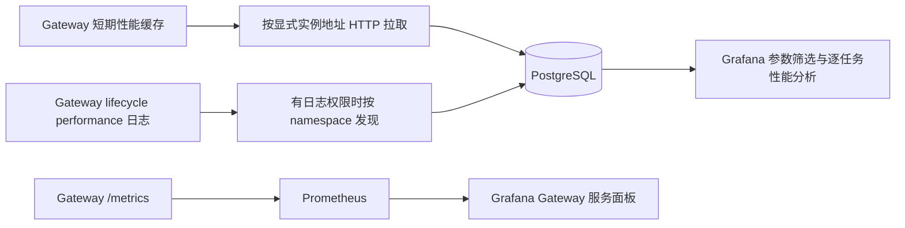

Video Gateway 提供服务级 Prometheus 指标、逐任务 API 计时和结构化生命周期日志。
Grafana 的 Gateway/Worker 运行面板读取 Prometheus；按请求参数筛选的性能分析面板读取
独立采集器写入的 PostgreSQL。两条链路使用不同的数据源。

## 接口和开关

| 数据或接口 | 用途 | 启用方式 |
| --- | --- | --- |
| Gateway `GET /metrics` | 服务级计数、队列、容量和耗时分布 | 随 Gateway HTTP 服务提供，默认端口 8000，由 `http.port` 配置 |
| `GET /v1/videos/{task_id}` 的 `metrics` | 当前/最终 attempt 的逐任务计时 | 无额外日志开关 |
| `GET /v1/videos/{task_id}/diagnostics` | 查询任务信息及已保存的诊断细项 | 无额外日志开关，旧任务可能缺少细项 |
| `GET /internal/v1/performance/records` | 供采集器增量拉取短期内存性能记录 | 缓存默认开启，默认保留 300 秒（5 分钟），受容量上限约束；拉取要求独立 Bearer Token，未配置时拒绝访问 |
| 生命周期日志 `video_task_lifecycle` | 任务状态转换、任务 ID、attempt 和计时 | INFO 日志，随生命周期事件输出 |
| 生命周期日志中的 `performance` | 请求参数、引用元数据及任务/模型计时，用于入库筛选 | Gateway 设置 `DINGO_VIDEO_PERFORMANCE_RECORDS=1`，默认关闭 |
| Gateway 媒体细项日志 | 定位媒体检查、打开和读取等耗时 | `DINGO_VIDEO_MEDIA_TIMING=1`，默认关闭 |
| Worker 模型 pipeline 计时 | 提示条件编码、去噪、解码等模型阶段 | Worker 设置 `--enable-diffusion-pipeline-profiler`，默认关闭 |
| Worker 引擎指标转发 | 将 Python registry 中的 Omni/Worker 指标导出给 Runtime | 设置 `DYN_SYSTEM_PORT`，保留 `disable_log_stats=false`；不要传 `--disable-log-stats` |

Gateway 自行提供 HTTP `/metrics`，其启动入口会清除 `DYN_SYSTEM_PORT`；不要用这个变量
配置 Gateway 的指标端口。Worker 的 Runtime 指标端口由 `DYN_SYSTEM_PORT` 配置，通常为 8081。
Worker profiler 会同步 GPU，可能影响性能；性能日志开关不会自动启用 profiler。

逐任务计时字段和边界见[接口使用说明](video-gateway-api.md)，
原生 vLLM-Omni 字段映射见[模型阶段计时规范](model-timing-schemas.md)。

`/live` 检查进程的 owner lease；`/ready` 检查恢复/启动状态、drain 状态以及任务/制品存储。
`/health` 与 `/ready` 相同。模型是否发现 Worker 需要看 `/v1/models` 的 `available`。
Prometheus 的 `up=1` 只说明本次抓取成功，不能证明 `/ready` 或每个模型都可用。

## 采集和标签

按 Pod IP 直接抓取每个 Gateway/Worker，避免通过业务负载均衡抓取，否则不同副本的 counter
会混到同一个时间序列中。抓取地址为对应 HTTP 端口的 `/metrics`。
可以使用 5 秒采集、4 秒超时；查询 `rate` 的窗口至少覆盖四个采集周期。

Gateway 原生标签包括 `pool`、`status`、`stage`、`schema`、`outcome` 等。
`namespace`、`pod`、`instance`、`model`、`job` 通常由 Prometheus Pod discovery/relabel 注入，
Gateway 指标本身不保证提供它们。Kubernetes namespace 和 Runtime 的 Dynamo namespace 不是同一概念。
Pod 选择条件由部署标签决定，`role=router` 单独使用可能同时选中普通 LLM Router。

指标按事件或使用情况创建，刚启动的 Gateway 可能没有对应 counter/histogram 序列。
阶段没有样本与阶段耗时为零不同。当前源码不提供按输出时长、去噪步数等组合分桶的
`dingo_video_perf_*` 指标；参数筛选通过后述 SQL 性能采集链路实现。

一次 Gateway `/metrics` 抓取会读取制品容量，并逐池读取队列、重试计数和任务状态索引；
etcd 实现目前对八种任务状态分别发出计数查询。Worker 发现/能力和 lease 正常复用本地缓存，
不会在每次抓取时调用所有 Worker。该接口不是只读取内存 counter 的静态导出接口。

## 多 Gateway 聚合

| 数据来源 | 聚合方法 | 原因 |
| --- | --- | --- |
| 同一套部署的共享任务、队列、Worker 和 admission slot gauge | 按部署及 pool 去重，可用 `max`，同时检查各副本健康及一致性 | 每个 Gateway 看到的是同一份共享状态，直接 sum 会重复 |
| Gateway 本地后处理积压、媒体内存和进程内存 | 按 Pod 展示，需要整套本地积压时再 sum | 每个副本处理不同的本地工作 |
| 同一 PVC/同一 quota 的容量 | 按实际共享存储范围去重 | 不按 Gateway 数量乘容量；不同 PVC 不能混用一个 max |
| 事件 counter 和耗时 histogram | 先逐序列 `rate`/`increase`，再 sum | 计数由处理事件的 Gateway 记录，进程重启会重置 |
| Worker detached 执行数/预取数 | 按 Worker Pod 展示，需要池总数时再 sum | 是各 Worker 的本地工作数 |

共享 gauge 的 `max` 只是展示选择，不是强一致快照。不同部署即使 pool 同名也不能合并；
同一 namespace 有多套部署时应由采集标签或数据源隔离。`pod` 标签用于本地指标和定位来源，
不能作为共享队列去重后的业务维度。

`increase(counter[时间范围])` 会对采集边界外推，因此请求数可能为小数，也不是精确审计账本。
永久下线的 Gateway 的历史序列在 Prometheus 保留期内仍可参与范围查询；直接 sum 当前 counter
既会受重启影响，也会遗漏已经消失的实例，不能称为“从首次部署以来的精确总请求数”。

## 任务和阶段指标

开启性能缓存时还提供 `dingo_video_performance_cache_records`、`dingo_video_performance_cache_bytes` 两个本机 Gauge，
以及 `dingo_video_performance_cache_expired_total`、`dingo_video_performance_cache_capacity_dropped_total` 两个淘汰 Counter。
`dingo_video_performance_cache_errors_total` 在缓存快照编码异常时增加。这些是进程内诊断，不增加 etcd 读操作；
过期淘汰不等于漏采，已成功读取的记录也会过期。缓存和 HTTP 拉取边界见[性能采集](performance-collection.md)。

以下名称均省略 `dingo_video_` 前缀。Histogram 实际导出 `_bucket`、`_sum`、`_count`。

| 名称 | 类型 / 原生标签 | 含义 |
| --- | --- | --- |
| `task_submissions_total` | Counter / pool, outcome, delivery_mode | 已记录的提交结果；outcome 包括 created、idempotent_replay、queue_full |
| `task_terminal_total` | Counter / pool, status, error_code | 状态进入 completed、failed、cancelled、expired 的转换事件 |
| `tasks` | Gauge / pool, status | 仍保留的任务记录数，按八种内部状态划分 |
| `queue_depth` | Gauge / pool | 共享队列深度，包含正常任务和等待重试任务 |
| `normal_queue_depth` | Gauge / pool | 从总队列扣除等待重试项后的深度 |
| `retry_waiting_tasks` | Gauge / pool | 等待重新派发的重试任务数 |
| `retry_credits_used` | Gauge / pool | 已占用的重试额度，不等同于执行中的任务数 |
| `task_stage_duration_seconds` | Histogram / pool, stage | queue、worker_queue、execution、finalize、result_handoff、artifact_visibility 的观察值 |
| `model_stage_duration_seconds` | Histogram / pool, schema, stage | Worker 返回的、按模型 schema 定义的阶段耗时 |

`task_submissions_total{outcome="created"}` 用于新建任务吞吐。该 counter 不是所有 HTTP 请求的计数：
校验失败和无 Worker 等路径不一定记录提交结果；已存在幂等任务的提前返回也可能不记录 replay。
`task_terminal_total` 是转换事件，一个 completed 任务随后 expired 会再记一次，应按 status 筛选。
`tasks` 是当前保留记录数，任务墓碑被清除后减少，不能作为累计处理量。

`task_stage_duration_seconds` 在各阶段记录点观察；不同阶段的样本数可能不同，重试或失败时
不保证一个业务任务在每个阶段各有一个样本。它不提供逐任务关联，也不是阶段开始时间的统计。

模型阶段只在成功结果交接从 `in_progress` 转为 `finalizing` 时观察，后续完成不会再记录一次。
其含义是 Worker 模型阶段，由 Gateway 汇总；模型交接成功后，即使 Gateway finalize 失败，
已经观察的模型样本仍在。缺失/无效阶段跳过，不补零、不回填历史、不为此额外读取 etcd。
父子阶段可能重叠，例如 decode 包含 video_decode/audio_decode，不能将它们全部相加。

按 namespace/pool 展示各模型阶段平均值：

```promql
sum by (pool, schema, stage) (
  rate(dingo_video_model_stage_duration_seconds_sum{namespace="$namespace",pool=~"$pool"}[$__rate_interval])
)
/
sum by (pool, schema, stage) (
  rate(dingo_video_model_stage_duration_seconds_count{namespace="$namespace",pool=~"$pool"}[$__rate_interval])
)
```

对应 P95：

```promql
histogram_quantile(0.95,
  sum by (pool, schema, stage, le) (
    rate(dingo_video_model_stage_duration_seconds_bucket{namespace="$namespace",pool=~"$pool"}[$__rate_interval])
  )
)
```

无样本时平均值可能为 NaN；不要强行显示为零。P95 是桶估算值，不能平均各 Pod 的 P95。
任务/模型阶段 histogram 当前最大有限桶为 1800 秒，超长尾和稀疏样本的分位值需要结合样本数判断。

## Worker 容量和本地后处理

以下为 Gateway 暴露的 pool gauge，名称省略 `dingo_video_`，均有 pool 标签。

| 名称 | 含义 |
| --- | --- |
| `workers` | 已发现的物理 Worker 注册数，不是 Pod 或 slot 数 |
| `worker_busy` | 有未隔离 lease 的当前注册 Worker 数，同一个 Worker 最多计一个 |
| `worker_execution_capacity` | 当前协商执行容量，受 Gateway 配置上限约束 |
| `worker_prefetch_capacity` | 额外预取准入容量，不是 GPU 计算并发 |
| `worker_admission_capacity` | 执行容量＋预取容量 |
| `worker_slots_busy` | 当前 slot 映射内占用的未隔离 lease 数 |
| `worker_slots_quarantined` | 当前 slot 映射内的隔离 lease 数 |
| `worker_slots_free` | 未占用的准入 slot；发现/lease 视图不健康时为零 |
| `worker_unmapped_leases` | 无法映射到当前 Worker/slot 的 lease，例如实例消失或容量缩减 |
| `worker_capacity_view_healthy` | 本 Gateway 的 Worker/lease 视图是否健康，1/0 |
| `worker_execution_capacity_configured` | 单 Worker 的配置执行上限，不是池总容量 |
| `worker_prefetch_capacity_configured` | 单 Worker 的配置预取上限 |
| `early_release_slot_enabled` | 本 Gateway 是否开启结果交接提前释放 slot，1/0 |
| `finalization_pending_local` | 本 Gateway 跟踪的后处理任务数，包括等待及运行项 |
| `finalization_concurrency_configured` | 本 Gateway 后处理并发上限 |
| `finalization_pending_limit_configured` | 本 Gateway 后处理 pending 上限 |

lease 覆盖 Worker 等待、执行和结果发布。slot 占用不能直接当成实际模型执行数。
例如一个 Worker 执行容量 1、预取容量 1，两个 lease 占用只表示两个任务已获准入；
可能一个正在执行，另一个等待执行。Worker 的实际执行/预取指标见后述 detached 指标。
空闲 slot 也不保证可以立即派发，媒体内存、重试策略及 Gateway 本地后处理限流仍可能阻塞。

提前交接释放 lease 后，任务仍可能处于 `finalizing`。共享 tasks 和本地 finalization_pending_local
是不同视角，不应互相替代。配置 gauge 应逐 Gateway 比较，以发现滚动升级期间的配置偏差。

## 内存和制品指标

以下名称省略 `dingo_video_`。除后述特别说明，原生没有 pool 标签。

| 名称 | 类型 | 含义 |
| --- | --- | --- |
| `media_memory_budget_bytes` / `media_memory_used_bytes` / `media_memory_peak_bytes` | Gauge | 本 Gateway 媒体内存预算、当前占用、进程存活期间峰值 |
| `media_memory_waiting_tasks` / `media_memory_active_tasks` | Gauge | 等待媒体内存和持有内存预算的任务数 |
| `media_legacy_input_encoded_bytes_total` / `media_legacy_output_encoded_bytes_total` | Counter | legacy Base64 路径累计编码字节，不代表 PVC 占用 |
| `media_payload_build_seconds_total` / `media_payload_build_total` | Counter | Worker payload 构造累计耗时及次数 |
| `media_finalize_seconds_total` / `media_finalize_total` | Counter | 未提前交接的媒体结果处理累计耗时及次数；提前交接后的独立 finalizer 不计入 |
| `media_result_oversize_total` | Counter | 结果超过大小限制的事件数 |
| `process_rss_bytes` / `process_peak_rss_bytes` | Gauge | Gateway 当前/峰值进程 RSS，不是容器或 GPU 内存 |
| `artifact_total_bytes` / `artifact_free_bytes` | Gauge | 制品存储可见容量和可用空间 |
| `artifact_sweep_due_tasks` | Gauge | 本 Gateway 最近 sweep 批次列出的到期任务数，不是所有历史到期任务 |
| `artifact_expired_tasks_total` | Counter | sweep 成功转换并清理 completed/failed/cancelled 到期任务的次数，主动 DELETE 不直接计入 |
| `artifact_orphan_candidates_total` / `artifact_orphan_trashed_total` | Counter | 孤儿任务目录候选累计次数 / 移入回收区域的次数 |
| `artifact_cleanup_failures_total` | Counter | 本 Gateway 清理失败次数 |
| `artifact_released_bytes_total` | Counter | 本 Gateway 对任务目录执行删除时统计的累计释放字节 |

制品容量优先读取 **artifact_store.root 本身**的 CephFS quota/rbytes；无有效 quota 时退回文件系统
disk_usage。若 root 是配额目录的子目录，不会自动向父目录查找配额；返回值未必是申请 PVC 的独立容量，
也不是对制品子目录递归求和。使用 total−free 展示已用空间前需确认实际口径。

`artifact_expired_tasks_total` 不是删除视频文件个数，也不覆盖全部 expired 转换：
主动 DELETE 转换/清理不增加它；清理失败时即使已经转换 expired，这次 sweep 也不会增加它，
后续仅处理 expired 墓碑的路径不补计。
若需要统计状态转换，应使用 `task_terminal_total{status="expired"}`，并按采集范围理解估算值。
孤儿候选可能被多个 sweep 重复观察，其 counter 也不是唯一任务数。

## 发现、重试、交接和 etcd

以下名称省略 `dingo_video_`；这些指标用于诊断。

| 名称 | 类型 / 原生标签 | 含义 |
| --- | --- | --- |
| `discovery_consistent` | Gauge / pool | Runtime Worker 视图与任务存储读取的发现信息是否一致，1/0 |
| `discovery_missing_instances` / `discovery_stale_instances` | Gauge / pool | 本地视图缺失/多余的实例数 |
| `discovery_last_consistent_timestamp_seconds` | Gauge / pool | 最近一致时刻的 Unix 秒时间戳 |
| `discovery_mismatch_checks_total` | Counter / pool, direction | 发现不一致的检查次数 |
| `discovery_watchdog_restarts_total` / `discovery_watchdog_errors_total` | Counter | 发现 watchdog 触发的 Runtime 重启请求 / 异常次数 |
| `gateway_owner_lease_lost_total` | Counter | 本 Gateway owner lease 丢失次数 |
| `dispatch_skips_total` | Counter / pool, reason | 调度轮次跳过原因；一次任务可能对应多个轮次 |
| `worker_admission_busy_total` | Counter / pool | Worker 返回 busy、不接受此次准入的次数 |
| `worker_liveness_checks_total` | Counter / pool, outcome | Worker 存活检查结果，不是失败任务数 |
| `worker_retries_total` | Counter / pool | Worker 故障导致重新排队的事件数 |
| `worker_lease_heartbeat_failures_total` | Counter / pool, reason | Worker lease 心跳失败次数 |
| `worker_lease_lost_total` | Counter / pool | 执行 lease 丢失事件 |
| `ha_takeovers_total` | Counter / pool, outcome | Gateway 任务接管结果，claimed/contended/failed |
| `result_handoff_total` | Counter / pool, outcome | 持久化结果交接事件 |
| `result_handoff_retries_total` | Counter / pool, reason | 结果交接重试次数 |
| `finalization_retries_total` | Counter / pool | 后处理失败后重试次数 |
| `artifact_visibility_failures_total` / `artifact_visibility_retries_total` / `artifact_visibility_recoveries_total` | Counter / pool, artifact | 跨客户端制品可见性失败、重试及恢复次数 |
| `detached_inline_results_total` | Counter / pool | 已接受的 detached inline 终态结果 |
| `detached_wait_connections_total` | Counter / pool, outcome | detached 等待连接附着或降级结果，不是当前连接数 |
| `detached_status_fallback_reads_total` | Counter / pool | 等待连接降级后读取制品状态的次数 |
| `etcd_request_duration_seconds` | Histogram / operation | Gateway etcd HTTP 请求耗时；长连接 watch 的耗时不是单次业务读延迟 |
| `etcd_request_errors_total` | Counter / operation | etcd 请求失败次数 |
| `etcd_watch_idle_refreshes_total` / `etcd_watch_rebuilds_total` | Counter / watch, pool | watch 正常空闲刷新 / 异常重建次数；全局任务 watch 的 pool 为 `_all` |

指标的事件次数不能自动换算成受影响的唯一任务数。例如同一任务可经历多次 heartbeat failure、
visibility retry 或 dispatch skip。具体 outcome/reason 以运行版本输出为准。

## Worker 和 vLLM-Omni

Worker `/metrics` 同时可能提供 Runtime 通用指标、我们添加的 detached 指标和引擎原生指标。
转发允许的前缀包括 `vllm:`、`vllm_omni:`、`dingo_video_worker_`；实际原生指标由引擎版本、
pipeline 和 registry 中已产生的样本决定。不能保证所有 LLM KV-cache/token 指标适用于视频生成。

| 指标 | 类型 / 标签 | 视频 Worker 中的意义 |
| --- | --- | --- |
| `dingo_video_worker_detached_execution_active` | Gauge | 当前已取得 execution permit、正在执行及输出/终态处理的任务数 |
| `dingo_video_worker_detached_prefetch_waiting` | Gauge | 已接受但仍等待 execution permit 的预取任务数 |
| `dingo_video_worker_detached_execution_capacity` | Gauge | Worker 配置的执行容量 |
| `dingo_video_worker_detached_prefetch_capacity` | Gauge | Worker 配置的额外预取容量 |
| `dingo_video_worker_detached_tasks_total` | Counter / outcome | Worker 已持久化的 completed/failed/cancelled 终态次数 |
| `dingo_video_worker_detached_queue_wait_seconds` | Histogram | 取得 execution permit 时记录的预取等待 |
| `dingo_video_worker_detached_execution_seconds` | Histogram | 从取得 permit 后执行到输出、终态写回及收尾的外层 wall time |

这些 detached 指标适合判断“一执行＋一预取”。Runtime 请求 handler 的 in-flight/耗时可能只
反映快速准入或等待 RPC，原生 `num_requests_running/waiting` 也可能只反映引擎内部 stage，
不能不加核对就当成完整视频任务的执行/预取数。

模型细阶段目前由 Worker 将 profiler 结果返回 Gateway，再通过 Gateway
`model_stage_duration_seconds` 汇总。API 中的模型 stages 字典不会自动变成同名的 Worker
Prometheus 指标。GPU 利用率、显存和功率来自 DCGM exporter，容器 CPU/内存来自集群容器指标，
都需要独立采集，不能期望 Gateway 或 Worker HTTP `/metrics` 包含它们。

## 性能采集和 SQL 分析

HTTP 模式按显式配置的每个 Gateway 地址拉取短期性能缓存，不需要 Kubernetes 日志权限。
缓存默认开启，保留时间为 300 秒（5 分钟），每进程上限为 50000 条、64 MiB；容量不足时提前淘汰。
拉取需要独立 Token；该模式不依赖下面的性能日志开关。
实例地址需要维护，不能把普通多副本业务 LB 当作完整采集入口。

Gateway 开启 `DINGO_VIDEO_PERFORMANCE_RECORDS=1` 后，在 completed/failed/cancelled 的 INFO
生命周期日志中附带 `performance`，当前 `schema_version=1`。记录包括输出时长/分辨率/步数、
引用类型和数量、已知的大小/分辨率/时长/帧数，以及本 attempt 的通用/模型耗时。
未知值为 null，原始 FPS×时长不冒充实际帧数；不额外扫描视频或读取 etcd。
摘要不包含提示词、媒体内容、文件路径；普通日志的安全与轮转仍由日志配置管理。



采集器独立于 Gateway，每个大区可部署一套。HTTP 目标列表和日志模式的 namespace 列表可热更新，
停止采集不删除历史数据或游标。采集器按 `(cluster_id, namespace, deployment, task_id, attempt)`
去重，写入记录和推进对应游标使用同一事务；具体设计及字段见[性能采集机制](performance-collection.md)。

HTTP 缓存淘汰、进程重启，以及日志模式下的日志轮转、Pod 删除和长期停采都会造成不可补回的缺失。临时 PostgreSQL 使用 emptyDir
时，Pod 重建会丢库；“从采集列表删除 namespace 不删数据”不改变存储生命周期。
采集器和 Prometheus 都不能作为完整审计账本。详细筛选页面不依赖把每个请求参数变成指标标签。
