<!--
SPDX-FileCopyrightText: Copyright (c) 2025-2026 NVIDIA CORPORATION & AFFILIATES. All rights reserved.
SPDX-License-Identifier: Apache-2.0

Note to AI agents: keep this README minimal (intro, support matrix, launch example,
Kubernetes example, topologies). Do not edit it unless the user explicitly asks
you to.
-->

# vLLM sidecar

> [!WARNING]
> **Experimental.** The sidecars and their deployment examples are
> experimental. Manifests, flags, and behavior may change without notice.

`dynamo-vllm-sidecar` connects a Dynamo worker to vLLM's native gRPC server
(`vllm-rs`). See the [sidecar overview](../README.md) for installation.

> [!TIP]
> For the best and latest support, use the upstream vLLM nightly image,
> which carries the latest gRPC server updates: [`vllm/vllm-openai:nightly`](https://hub.docker.com/r/vllm/vllm-openai/tags?name=nightly).

It is a standalone Rust executable and is also compiled into
`ai-dingo-runtime` for the importable `dingo.vllm.sidecar` launcher.

## Support matrix

| Feature | Supported |
|---------|-----------|
| Aggregated | Yes |
| Disaggregated | Yes |
| KV routing | Yes |
| Kubernetes multinode tensor parallelism (TP) and hybrid load balancing (hybrid-LB) data parallelism (DP) | Yes |

See [support notes](../SUPPORT_NOTES.md#vllm) for feature restrictions and operational limits.

## Run locally

See [`launch/`](launch/) for all topologies. For example, aggregated serving on
one GPU:

```bash
export DYN_DISCOVERY_BACKEND=file   # single host: no etcd or NATS needed
lib/sidecar/vllm/launch/agg.sh
```

In a second terminal:

```bash
curl -s localhost:8000/v1/chat/completions \
  -H 'Content-Type: application/json' \
  -d '{"model":"Qwen/Qwen3-0.6B","messages":[{"role":"user","content":"Hello"}],"max_tokens":32}'
```

## Deploy on Kubernetes

Before applying, replace `<your-registry>/dynamo-sidecar` in the manifest with a
[sidecar image](../README.md#docker).

```bash
dynamo-vllm-sidecar \
  --grpc-endpoint 127.0.0.1:50051
```

After installing `ai-dingo`, the Python module runs the same native worker:

```bash
python -m dingo.vllm.sidecar \
  --grpc-endpoint 127.0.0.1:50051
```

Use `DYN_SIDECAR_GRPC_ENDPOINT` instead of `--grpc-endpoint` when the endpoint is
provided through the environment.

### Tool-call and reasoning parsing

Configure Dynamo frontend parsing on the sidecar with the same flags used by
`python -m dingo.vllm` and `python -m dingo.sglang`. For the Qwen3 example above:

```bash
python -m dingo.vllm.sidecar \
  --grpc-endpoint 127.0.0.1:50051 \
  --dyn-tool-call-parser hermes \
  --dyn-reasoning-parser qwen3
```

`DYN_TOOL_CALL_PARSER` and `DYN_REASONING_PARSER` provide the equivalent environment
settings. Use Dynamo parser names. The sidecar advertises these names to the
Dynamo frontend, which parses the generated output. vLLM's gRPC generation path
bypasses its chat output parsers, so setting native vLLM parsers does not parse
the response twice.

When these flags and environment variables are absent, the sidecar advertises no
parsers. It does not infer Dynamo parser settings from vLLM's native parser names.

Dynamo parsers need vLLM to run without its own reasoning parser, so start
`vllm-rs` with `--reasoning-parser none`, as the launch scripts and deploy
examples do. vLLM's reasoning parser decides where structured output starts from
per-request reasoning metadata (`reasoning_ended` / `reasoning_parser_kwargs`)
that the gRPC protocol cannot carry. If a Dynamo parser flag is set and vLLM
reports its own reasoning parser, the sidecar exits at startup. With no engine
reasoning parser, vLLM never reads that metadata, so the sidecar removes it, and
vLLM applies structured output, such as a JSON schema or a required or named
`tool_choice`, from the first output token. If vLLM runs its own reasoning
parser, a request that carries this metadata still fails.

Requests that require visible stop-token preservation or `max_thinking_tokens`
still fail explicitly in the gRPC request converter. These limitations affect
some tool terminators, such as `harmony` tool calls.

### RL workflows

Start vLLM with the capabilities required by the workflow, then opt the sidecar into RL discovery. This example targets vLLM 0.28:

```bash
vllm-rs serve Qwen/Qwen3-0.6B \
  --host 0.0.0.0 \
  --port 8000 \
  --grpc-port 50051 \
  --enable-sleep-mode \
  --weight-transfer-config '{"backend":"nccl"}'

DYN_SYSTEM_PORT=8081 dynamo-vllm-sidecar \
  --grpc-endpoint 127.0.0.1:50051 \
  --vllm-http-endpoint http://rollout-0.rl.svc.cluster.local:8000 \
  --vllm-rl-world-size 1 \
  --enable-rl
```

For newer vLLM releases, use the same command without `--vllm-rl-world-size`; the nonzero value reported over gRPC is authoritative.

Replace `rollout-0.rl.svc.cluster.local` with a private address that the RL controller can route to. Binding vLLM to `0.0.0.0` exposes both its HTTP and gRPC listeners, so restrict both ports with host firewall rules, Kubernetes NetworkPolicy, or an equivalent trusted-network control. A colocated sidecar can continue to use loopback for `--grpc-endpoint`; the advertised HTTP URL must be routable from the controller, not merely from the worker.

`--enable-rl` (or `DYN_ENABLE_RL=true`) requires the Dynamo system server (`DYN_SYSTEM_PORT=0` or a positive port) and registers `dyn://<namespace>.<component>.rl`, which lets the Dynamo frontend discover this worker and its `/engine/control/*` and `/engine/update/*` routes through `/v1/rl/workers`. The sidecar advertises pause/resume, sleep-status, and weight-version controls when the vLLM server reports the RL gRPC API; mutating sleep/wake routes require `--enable-sleep-mode`, weight-transfer routes require `--weight-transfer-config`, and draft updates require speculative decoding support. The sidecar publishes `--vllm-http-endpoint` (or `VLLM_HTTP_ENDPOINT`) only as part of this RL worker metadata.

Native vLLM lifecycle and weight-update operations use the typed gRPC Control service and do not require `--vllm-http-endpoint`. Configure the HTTP base URL only when an RL framework needs a compatibility operation that is not represented by the typed service, such as a custom `worker_extension_cls` method invoked through `/collective_rpc`.

vLLM 0.28 does not report its engine world size over production gRPC or HTTP routes. When RL is enabled against that release, pass `--vllm-rl-world-size` (or `DYN_VLLM_RL_WORLD_SIZE`) with the total process count across tensor, pipeline, prefill-context, and data parallelism (`TP * PP * PCP * DP`); the example uses the default one-rank topology. Do not substitute decode-context parallelism for PCP because those settings do not have a one-to-one relationship. Newer vLLM releases report the per-data-parallel engine value over gRPC, so omit the compatibility option for them.

The HTTP value must be a controller-routable `http://` or `https://` base URL. Path prefixes are preserved, so a reverse proxy can advertise a value such as `https://rollout.example.internal/vllm-admin`; downstream clients append the compatibility route beneath that prefix. User information, query strings, and fragments are rejected. Do not place credentials or tokens in the URL.

The update request bodies match vLLM's RL HTTP schemas: `init_weight_transfer_engine` requires `{"init_info": {...}}`, `update_weights` requires `{"update_info": {...}}`, `finish_weight_update` accepts `{"weight_version": "..."}`, and `update_weight_version` requires `{"new_version": "..."}`. Weight tensors remain on the configured NCCL, IPC, or sparse-NCCL transport; only backend metadata crosses gRPC.

The RL endpoint, engine routes, and raw HTTP compatibility surface are administrative interfaces that can pause serving, release GPU memory, and replace model weights. The sidecar does not add HTTP authentication to the advertised URL. Enable these interfaces only on trusted request and system networks, or place the HTTP endpoint behind an authenticated private proxy without embedding credentials in the published URL.

The sidecar discovers `model_id`, the served name, context length, KV capacity, scheduler limits, data-parallel topology, and KV-event sources through `vllm.Control`. `model_id` must be readable locally or fetchable by Dynamo for tokenization and chat templates. Parser names returned by Control are used for engine identity validation; configure Dynamo frontend parsers explicitly as described above.

For hybrid data parallelism, run one vLLM gRPC frontend and sidecar per node with `--data-parallel-hybrid-lb` and the node's local DP size and starting rank. Point each sidecar's `--grpc-endpoint` at its local frontend. This requires a vLLM build that reports local DP size.

For a multimodal model, the sidecar resolves the model's chat image-placeholder
token from its local or Hugging Face configuration and attaches it to every ZMQ
source. This lets backend events use the same canonical image hash as frontend
routing. If the model configuration or exact-routing prerequisites cannot be
resolved, inference remains available but falls back to ordinary text-prefix KV
routing.

The forwarded 64-hex vLLM media identifier contains Dynamo's 64-bit routing hash
and becomes part of vLLM's encoder and prefix-cache identity. Treat passed-through
HTTP URLs as immutable: changing the bytes behind one URL can reuse stale media
cache state. User-supplied media UUIDs retain their vLLM semantics and disable
exact Dynamo multimodal credit.

Aggregated serving is the default. The sidecar role is configured explicitly because the current Control API does not report it:

- Encoder: `--disaggregation-mode encode`
- E+PD downstream: aggregated mode plus `--route-to-encoder`
- E+P+D prefill: `--disaggregation-mode prefill --route-to-encoder`
- E+P+D decode: `--disaggregation-mode decode`

### Encoder disaggregation

Encoder disaggregation uses Dynamo's Encode worker discovery and routing contract. All media items in one request are sent together to one Encode worker; per-item fan-out is not supported. Text-only requests bypass Encode workers. If the encoder hop fails, the downstream request retains its original media and vLLM encodes it inline.

Encode workers accept image and video media, also together in one request. The Encode worker runs the vision encoder, but each engine that receives the request still fetches and preprocesses all of its media, and decodes each video.

The encoder vLLM instance must use an EC producer connector and the aggregated or prefill instance must use the matching EC consumer connector. The sidecar treats the connector metadata as an opaque JSON object and carries it over the existing gRPC `KVCacheParameters.ec_transfer_params` and `FinishInfo.ec_transfer_params` fields. In E+P+D, decode's vLLM gRPC frontend uses that metadata with the original media description to reconstruct model-specific positions such as Qwen-VL mRoPE, then removes the EC parameters before EngineCore consumes the prefill KV handoff. Decode therefore uses NIXL without an EC connector and does not load the encoder embedding again.

The local examples use `Qwen/Qwen2.5-VL-3B-Instruct` with vLLM's `ECExampleConnector` and a shared directory. The directory must be accessible at the same path from the producer and consumer. Each script creates and removes an isolated temporary directory unless `EC_SHARED_STORAGE_PATH` names a caller-managed directory:

In the filenames, `e_pd` means one Encode worker plus one aggregated Prefill/Decode worker, while `epd` means separate Encode, Prefill, and Decode workers.

```bash
# Encoder + aggregated prefill/decode (2 GPUs)
lib/sidecar/vllm/launch/disagg_multimodal_e_pd.sh

# Encoder + NIXL prefill + decode (3 GPUs)
lib/sidecar/vllm/launch/disagg_multimodal_epd.sh
```

The examples run one `vllm-rs` process and one Dynamo sidecar for each role. The encoder uses `--mm-encoder-only`, eager execution, and disabled prefix caching. The sidecar rejects media UUIDs that contain path separators, NUL bytes, or dot path components before forwarding them as connector keys. `ECExampleConnector` is a validation connector; production deployments should select an EC connector whose transport and storage semantics fit the deployment.

The sidecar opens eight gRPC connections by default. This avoided
connection-level throttling in high-concurrency sidecar tests. Override the
pool size with `--grpc-connections` or `DYN_SIDECAR_GRPC_CONNECTIONS`.

Connection startup uses a 30-second timeout per attempt, a one-second retry
interval, and a 30-minute deadline for establishing the full connection
pool. Override them with `--grpc-connect-attempt-timeout-secs`,
`--grpc-retry-interval-secs`, and `--grpc-startup-deadline-secs`, or with the
corresponding `DYN_SIDECAR_GRPC_*` environment variables.

Each request owns its response stream but borrows a channel from the shared pool. Aggregate and prefill cancellation drops only that request's stream. Decode cancellation first submits the decode request and retains its stream until the first output token or a response containing `finish_info`, so a NIXL receiver can complete and release the transferred KV; it then drops the stream. If the stream ends early, returns a gRPC error, or produces an invalid response after cancellation, the sidecar logs the failure and reports the request as cancelled. vLLM automatically aborts the corresponding engine request while the pooled HTTP/2 connection remains available to other requests. The sidecar does not call the Control `Abort` RPC.

## Test without vLLM or a GPU

Use the CPU-only `dynamo-vllm-mocker-server` to exercise the same Inference, Control, and health contracts:

```bash
cargo run -p dynamo-vllm-mocker --bin dynamo-vllm-mocker-server -- \
  --listen 127.0.0.1:50051 \
  --model mocker-model \
  --extra-engine-args '{"speedup_ratio":1000}'

cargo run -p dynamo-vllm-sidecar --bin dynamo-vllm-sidecar -- \
  --grpc-endpoint 127.0.0.1:50051
```

The mocker does not advertise RL capabilities; use a compatible vLLM server for RL route testing.

See [`../../mocker/servers/vllm/README.md`](../../mocker/servers/vllm/README.md)
for aggregated and prefill/decode examples, supported Mocker configuration,
and fidelity limits.

See [`deploy/`](deploy/) for all manifests. For example, aggregated serving:

```bash
kubectl apply -f lib/sidecar/vllm/deploy/agg.yaml -n <namespace>
kubectl port-forward -n <namespace> svc/vllm-sidecar-agg-frontend 8000:8000
```

Multinode deployments use complete `leader` and `worker` role PodTemplates. See
[`multinode_tp.yaml`](deploy/multinode_tp.yaml), [`multinode_dp.yaml`](deploy/multinode_dp.yaml),
and the [vLLM sidecar guide](https://github.com/ai-dynamo/dynamo/blob/main/docs/fern/pages/developer-guide/knowledge-base/modular-components/backends/vllm/sidecar.md#deploy-on-kubernetes).

## Topologies

The frontend reaches each sidecar over Dynamo's request, discovery, and event
planes; the sidecar reaches the engine over its native gRPC API. Dashed arrows
carry KV events.

### Single-Node TP

One engine on one node, with one sidecar.



### Multi-Node TP

One engine spans two nodes. Only the leader node has a sidecar; the follower
node holds the remaining TP ranks.



### Multi-Node DP

Hybrid DP load balancing: each node runs vLLM for its local DP ranks plus a
sidecar that serves requests. The frontend routes to either node.



## Deploy on Kubernetes (quick start)

`deploy/agg.yaml` runs an aggregated deployment (a frontend plus one worker pod
that colocates the sidecar with a vLLM engine). `deploy/disagg.yaml` runs
disaggregated prefill/decode with NIXL KV transfer.

There is no published sidecar image yet, so build and push the image from
`lib/sidecar/Dockerfile`. It contains the vLLM, SGLang, and TensorRT-LLM
sidecar executables; these manifests run `dynamo-vllm-sidecar` as the container
command.

The vLLM engine runs in `spec.components[*].podTemplate.spec.containers[name=main]`, alongside the
restartable Dynamo sidecar in `spec.components[*].podTemplate.spec.initContainers[name=runtime]`.
Declaring `spec.components[*].podTemplate.spec.initContainers[name=runtime]` activates Dynamo sidecar mode;
keep `restartPolicy: Always`.

The operator injects probes into `spec.components[*].podTemplate.spec.initContainers[name=runtime]`:
`/live` for startup and liveness, and `/health` for runtime readiness, independent of engine loading.
Kubernetes-native gRPC probes on port `50051` gate pod readiness and restart
unhealthy engine containers, with a 30-minute startup budget; increase this for
larger models. The engine listens on `0.0.0.0` for kubelet probes, while the
sidecar connects over loopback.

The Dynamo vLLM runtime image exposes `vllm-rs` on `PATH`. On CPU and XPU,
check that the binary is available with `command -v vllm-rs`. The example
manifests use upstream vLLM images and locate the binary inside the Python
package.

### Prerequisites

- A Kubernetes cluster (**v1.29+**, or v1.28 with the `SidecarContainers` feature
  gate) with the Dynamo operator and a GPU node (multiple GPUs plus an RDMA fabric
  for `disagg.yaml`). The native sidecar in `spec.components[*].podTemplate.spec.initContainers[name=runtime]`
  uses `restartPolicy: Always`, which requires that version.
- `kubectl` set to that cluster, and a namespace to deploy into.
- A container registry you can push to and the cluster can pull from.

### 1. Build and push the sidecar image

Build and push the image to a registry your cluster can pull from:

```bash
docker buildx build --platform linux/amd64,linux/arm64 \
  -f lib/sidecar/Dockerfile \
  -t <your-registry>/dynamo-sidecar:1.7.0 --push .
```

See [Build the image](../README.md#build-the-image) for a single-architecture
build. These manifests set the container `command` to
`dynamo-vllm-sidecar`.

### 2. Point the manifest at your image

In `deploy/agg.yaml` (and `deploy/disagg.yaml`), set
`spec.components[*].podTemplate.spec.initContainers[name=runtime].image` to the one you pushed.
Keep the vLLM engine image in `spec.components[*].podTemplate.spec.containers[name=main].image`.
Add `imagePullSecrets` if your registry is private.
For a custom image tag without a semantic version, set `spec.components[*].runtimeVersionOverride`
to the Dynamo version built into the sidecar image.

For custom mounts on `spec.components[*].podTemplate.spec.initContainers[name=runtime]`, declare matching entries in
`spec.components[*].volumes`; the operator does not infer PVC volumes from
init-container mounts. `spec.components[*].compilationCache` configures the engine in
`spec.components[*].podTemplate.spec.containers[name=main]` and creates its pod volume; it does not
mount the cache into `spec.components[*].podTemplate.spec.initContainers[name=runtime]`.

For TLS-enabled deployments, mount the certificate Secrets on the runtime container.
A co-located frontend also needs its own certificate mounts. See the
[sidecar-mode TLS example](https://github.com/ai-dynamo/dynamo/blob/main/docs/fern/pages/kubernetes/installation/tls.md#dynamo-sidecar-mode).

### 3. Deploy

```bash
kubectl apply -f lib/sidecar/vllm/deploy/agg.yaml -n <namespace>
```

Wait for the worker pod to reach `2/2 Running`:

```bash
kubectl get pods -n <namespace> -w
```

### 4. Send a request

```bash
kubectl port-forward -n <namespace> svc/vllm-sidecar-agg-frontend 8000:8000 &

curl -s localhost:8000/v1/models | jq .

curl -s localhost:8000/v1/chat/completions \
  -H 'Content-Type: application/json' \
  -d '{"model":"Qwen/Qwen3-0.6B","messages":[{"role":"user","content":"Hello"}],"max_tokens":32}' | jq .
```

### Disaggregated

`deploy/disagg.yaml` runs prefill and decode as separate worker pods with NIXL
KV transfer. It needs multiple GPUs and an RDMA fabric, and both worker pods
must reach `2/2 Running`. Apply it the same way and call the frontend as above.
